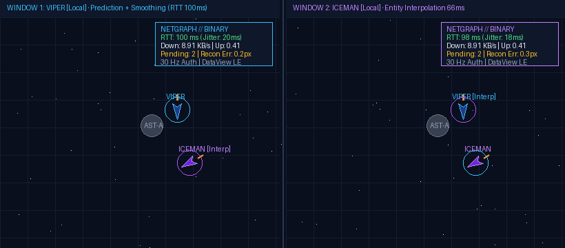
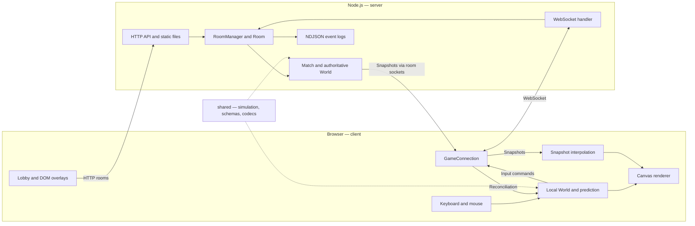

# Dogfight — a guide for React developers

Dogfight is a browser space game built across six JavaScript university labs. You steer a ship, shoot, dodge asteroids, collect pickups, and share an arena with other players. The current version uses **TypeScript, Canvas 2D, Vite, Node.js, WebSockets, and Zod**.

If you know React, the familiar parts are forms, asynchronous loading, UI state, and subscriptions. The new part is a simulation that advances continuously. The browser predicts movement for immediate feedback; the server runs the authoritative match and sends state back to each player. The current UI uses vanilla DOM and Canvas; React is a useful reference for understanding its architecture.



## Contents

- [Run the project](#run-the-project)
- [Play and inspect it](#play-and-inspect-it)
- [Architecture](#architecture)
- [Translate React concepts](#translate-react-concepts)
- [Application lifecycle](#application-lifecycle)
- [The game loop](#the-game-loop)
- [A keypress across the network](#a-keypress-across-the-network)
- [Shared simulation and contracts](#shared-simulation-and-contracts)
- [API and configuration](#api-and-configuration)
- [Making changes](#making-changes)
- [Checks and troubleshooting](#checks-and-troubleshooting)
- [Lab versions and reports](#lab-versions-and-reports)

## Run the project

Use **Node.js 22 and npm**. Run commands from the repository root. npm workspaces install and link all three packages, so separate installs inside them are unnecessary.

```bash
npm ci
```

Start the backend in one terminal:

```bash
npm run dev:server
```

Start Vite in a second terminal:

```bash
npm run dev:client
```

Open **http://localhost:5173**, or the URL printed by Vite if that port is occupied. The backend listens on **3000** by default. `npm run dev` also starts the client; the server still needs its own terminal.

During development, [Vite](client/vite.config.js) proxies `/api` and `/ws` to `127.0.0.1:3000`. The browser derives its socket URL from the current page host, so requests and WebSocket traffic go through Vite.

To serve the built frontend from Node:

```bash
npm run build
npm start
```

Open **http://localhost:3000**. The build produces `client/dist`; Node serves it alongside the API and socket endpoint. `npm start` runs server TypeScript through `tsx` and needs installed dependencies. `npm run preview` previews the client build; use `npm start` for the combined app.

## Play and inspect it

1. Start both development servers and open the client in two windows.
2. Enter distinct pilot names, select the same sector, and use the lobby's join button in each window.
3. Fly and fire in one window; observe that ship from the other.
4. Press `N` to open Netgraph. Compare JSON and binary encoding, then add latency or jitter and observe snapshot delivery and corrections.

| Control | Action |
| --- | --- |
| `W` / Up arrow | Thrust forward |
| `A` / Left arrow | Turn left |
| `D` / Right arrow | Turn right |
| Space / click in the game area | Fire |
| `Esc` / `L` | Toggle lobby |
| `N` / `4` | Toggle Netgraph |
| `K` | Alternate the detached-method `this` bug experiment and its `.bind()` fix |
| `H` / `P` | Spawn a local asteroid / random pickup for lab experiments |
| `B` | Run the asset-loading benchmark; inspect the console |
| `1` / `2` / `3` | Toggle busy-wait / interval scheduling / variable timestep experiments |

The lab experiment keys deliberately change runtime behavior. Reload for a clean comparison. `H` and `P` affect the local simulation; they are not sent as multiplayer commands. Sound starts after a click or keypress because the audio context needs a user gesture.

## Architecture

There are three npm workspace packages. Client and server both import `shared`, but each owns its own `World` instance. Sharing code does not share memory or automatically synchronize state.



| Location | Responsibility | Entry points |
| --- | --- | --- |
| `client/src` | Startup, input, audio, UI, drawing | [main.ts](client/src/main.ts), [loop.ts](client/src/loop.ts) |
| `client/src/net` | Socket service, prediction, reconciliation, interpolation | [connection.ts](client/src/net/connection.ts), [prediction.ts](client/src/net/prediction.ts), [interpolation.ts](client/src/net/interpolation.ts) |
| `client/src/lobby` | Room data and DOM presentation | [lobby.ts](client/src/lobby/lobby.ts), [lobbyView.ts](client/src/lobby/lobbyView.ts) |
| `server/src` | HTTP, sockets, rooms, matches | [index.ts](server/src/index.ts), [ws.ts](server/src/ws.ts), [rooms.ts](server/src/rooms.ts), [match.ts](server/src/match.ts) |
| `shared/src/sim` | Entity state and game rules, usable in browser and Node | [world.ts](shared/src/sim/world.ts), [ship.ts](shared/src/sim/ship.ts) |
| `shared/src/protocol` | Runtime schemas, inferred types, parsers | [protocol.ts](shared/src/protocol/protocol.ts) |
| `shared/src/codec` | JSON and binary wire representations | [spec.ts](shared/src/codec/spec.ts), [binaryCodec.ts](shared/src/codec/binaryCodec.ts) |
| `server/test` | Simulation, codec, network, migration tests | [lab06.test.js](server/test/lab06.test.js) |
| `scripts` | Headless multiplayer verification and benchmarks | [verify-dogfight.js](scripts/verify-dogfight.js) |

The server keeps rooms and players in memory. Each `Room` owns a `Match`, its players, and an event log. The match owns the authoritative world, player ships, latest inputs, tick scheduling, and snapshots. Restarting Node recreates the default rooms; live matches have no database persistence.

## Translate React concepts

These are analogies for navigating the existing implementation:

| In a React application | In this repository |
| --- | --- |
| App initialization and top-level coordination | `main.ts` constructs and connects runtime objects |
| UI state, such as selected room or loading status | `Lobby` fields and the `gameState` variable |
| A component rendering room data | `LobbyView` explicitly updates DOM elements |
| A service or external store | `GameConnection`, `World`, and the typed event bus |
| An action | An input command such as `{ thrust, turn, fire, seq }` |
| An optimistic update followed by a server response | Prediction followed by reconciliation and replay |
| An effect subscription with cleanup | `bus.on(name, callback)` returns an unsubscribe function |
| A mutable runtime held in a ref | Long-lived world, ship, loop, and socket objects |

Game entities are mutable class instances. A simulation step updates positions, velocities, health, and timers in place. Canvas reads that state and paints pixels explicitly. Each mutation does not trigger a component render.

The server owns the authoritative multiplayer result. The browser holds predicted local state, buffered remote snapshots, and presentation state. A position on screen can differ briefly from the server position because rendering applies a correction offset or interpolates between snapshots.

If adding React later, start with lobby, chat, settings, and connection indicators. Keep the simulation in a long-lived runtime, expose UI snapshots through an adapter, and let Canvas draw the arena. An effect could start the runtime and clean up listeners, timers, animation frames, and the socket on unmount. Design that lifecycle to tolerate development remounts. A React runtime adapter is a possible extension; it is not implemented here.

## Application lifecycle

Read [main.ts](client/src/main.ts) as the composition root: it wires the modules together.

1. **Create browser services.** Input listeners, Canvas sizing, prediction, interpolation, and Netgraph are initialized. Socket listeners are registered for welcome messages and snapshots.
2. **Load assets.** `startApplication()` calls `loadAll('/assets/manifest.json', ...)`. Progress paints the loading screen. The loader handles assets and retries; decoded sounds are passed to the audio system.
3. **Create an initial world.** `setupWorldForRoom()` constructs the local world, ship, asteroids, and pickups, resets prediction/interpolation buffers, subscribes audio/HUD to world events, and opens the room connection. Startup initially uses `room-alpha`, before showing the lobby.
4. **Show the lobby.** The animation loop starts, `Lobby` and `LobbyView` are constructed, and rooms are polled every four seconds. Fetching validates responses and supports cancellation. A static room-list fallback can display sectors when the backend is unavailable.
5. **Join a selected room.** The callback unlocks audio, creates the room's local world, reconnects, and switches `gameState` to `playing`. The server welcome message supplies the ship ID and seed used by the client.
6. **Run continuously.** Simulation consumes input and advances local state. Snapshots feed reconciliation and interpolation. Rendering paints the world and HUD.

`Lobby` owns data and requests; `LobbyView` owns DOM updates and UI listeners. This resembles separating a React data hook from a view component.

## The game loop

A form can wait for the next event. A moving ship needs another position even if a key remains held and no new `keydown` arrives.

[createLoop](client/src/loop.ts) normally schedules frames with `requestAnimationFrame` and advances simulation using a **fixed `1/60` second step**:

```text
animation frame
  measure elapsed time
  add elapsed time to an accumulator
  while enough time remains for a simulation step:
    simulate(1 / 60)
    subtract one step from the accumulator
  render(accumulator / step, statistics)
  request the next frame
```

Simulation and rendering have separate clocks. A slow frame can require several simulation steps; a fast frame can require none. The loop caps a long frame's elapsed time at 0.25 seconds to limit catch-up work. Interval and variable-step modes exist for lab experiments.

`simulate()` reads held keys, predicts input, sends it, updates smoothing, advances the local world, and updates HUD timers. `render()` draws backgrounds, the predicted local ship, remote entities, and UI. The loop provides `alpha`, but the current main renderer uses prediction smoothing and network interpolation for ship display rather than blending the saved local ship states with `alpha`.

The server has a separate **30 Hz** loop in [Match](server/src/match.ts), with a fixed `1/30` second step. It uses `setTimeout` against an advancing target time and records tick duration and scheduling jitter. Browser frame rate and server tick rate need not match.

## A keypress across the network

Suppose you hold `W` to accelerate:

1. **Capture intent.** `input.ts` records held keys in a `Set`. Each simulation step maps them to thrust, turn, and fire.
2. **Predict immediately.** `PredictionManager.predictStep()` assigns the next sequence number, calls shared ship movement code, and stores the command and timestep in `pendingInputs`.
3. **Send the command.** `GameConnection.sendInput()` sends binary or JSON over `/ws`. A JSON command looks like this:

   ```json
   { "type": "input", "seq": 42, "tick": 0, "thrust": 1, "turn": 0, "fire": false }
   ```

   The client currently sends `tick: 0`; `seq` is used for acknowledgements. It sends control intent, with the server calculating the position.

4. **Validate and retain input.** `ws.ts` checks messages and rate limits, then calls `Match.queueInput()`. The match retains the latest input per player in a map and reuses it until another input replaces it. Every client command does not become a separate server physics step.
5. **Advance the authoritative world.** At 30 Hz, the match builds a ship-input map and runs `world.step()`. Shared rules apply movement, wrapping, collisions, cleanup, and respawn timers.
6. **Send a snapshot.** Each player gets entities, server time, tick, and a personalized `ackSeq`. The current sequence tracker updates when input is queued; snapshots are broadcast after the world step. Intermediate inputs can be coalesced into the retained latest control state.
7. **Reconcile the local ship.** The client drops pending commands with `seq <= ackSeq`, restores position, velocity, angle, health, and shield from the authoritative ship record, then replays remaining inputs with their saved timesteps.
8. **Smooth the display.** Reconciliation can change position. A visual offset decays toward zero so ordinary corrections appear gradually, while the underlying simulation already uses the corrected position.

For example, with pending inputs 41–44 and an acknowledgement of 42, the client removes 41 and 42, restores the server state, then replays 43 and 44. This resembles optimistic UI reconciling a response, but runs continuously and must account for time.

### Why other players are rendered differently

The client knows its own input immediately. It learns another player's movement from snapshots.

[InterpolationManager](client/src/net/interpolation.ts) buffers snapshots with their local arrival times and renders remote entities about **66 ms behind the current arrival timeline**. It finds two snapshots around that time and blends positions and angles. Wrapping logic chooses the short path across an arena edge. Without a newer snapshot to blend toward, it uses the latest available state.

This adds a small display delay in exchange for smoother motion between 30 Hz updates. Prediction makes your ship responsive; interpolation makes remote movement smooth.

### Current implementation boundaries

This educational implementation combines local simulation and server snapshots. `main.ts` advances the local world in addition to the explicit prediction step. The renderer combines local entities with remote snapshots, skipping remote asteroids and pickups when a matching local ID exists. Snapshots reconcile selected ship fields rather than replacing the entire client world.

Shared rules and seeded randomness therefore do not guarantee identical live worlds. Different timesteps, input coalescing, local experiment actions, and independently created entities can produce differences. Determinism tests verify equal simulations under equal conditions; they do not establish complete live multiplayer synchronization. Keep this distinction in mind when investigating corrections or adding gameplay.

## Shared simulation and contracts

[World](shared/src/sim/world.ts) stores entities in a `Map` keyed by `EntityId`. It allocates IDs, spawns/despawns entities, advances rules, emits events, and serializes snapshots. Its entity union includes ships, bullets, asteroids, and pickups.

A world step:

1. Applies ship input and updates other live entities.
2. Wraps entities across arena boundaries.
3. Resolves collisions and emits events.
4. Removes dead non-ship entities and advances ship respawn timers.
5. Replenishes asteroids when needed.

The simulation has no DOM, Canvas, or browser audio dependency. Both Node and browser import it through `shared`. A seeded `PRNG` makes random choices repeatable with equal seeds, starting state, input, and timesteps.

The typed [event bus](shared/src/events.ts) lets rules emit `fired`, `hit`, `pickup`, or `respawn` events. Audio and HUD subscribe on the client, keeping presentation out of collision rules. TypeScript checks event payloads; subscribing returns a cleanup function.

### Types at development time, schemas at runtime

TypeScript helps while writing code, but received JSON is runtime data. [protocol.ts](shared/src/protocol/protocol.ts) defines Zod schemas, infers types from them, and exposes parsers returning success or failure.

Messages use a discriminated `type` field. After parsing, switching on `type` narrows the payload; `assertNever()` helps catch unhandled variants. Branded numbers such as `EntityId`, `Tick`, and `Seq` distinguish concepts otherwise represented as `number`; constructors validate ranges. Readonly snapshot types constrain accidental mutation by consumers.

All packages inherit strict settings from [tsconfig.base.json](tsconfig.base.json), including `noUncheckedIndexedAccess`. Vite builds browser code; `tsx` executes server TypeScript. Run typechecking separately because a Vite build does not replace it.

### Two wire formats, one model

JSON is convenient for inspecting messages. Binary uses a little-endian `DataView` layout: a 16-byte snapshot header plus 24 bytes per entity, and 14 bytes per input frame. Angles are quantized with a factor of 1000. Codecs validate layout/version/ranges and convert messages into the shared model. See [spec.ts](shared/src/codec/spec.ts) for exact sizes.

Join, chat, and other control messages also use JSON; choosing binary does not turn every message into binary.

## API and configuration

HTTP handles discrete requests; WebSockets carry ongoing match traffic.

| Endpoint | Purpose |
| --- | --- |
| `GET /health` | Process health, uptime, room count, memory |
| `GET /api/rooms` | Room list for polling |
| `POST /api/rooms` | Create a room from a validated JSON body |
| `GET /api/stats` | Per-room tick, entity, codec, latency metrics |
| `GET /api/replays/:filename` | Stream a recorded NDJSON event log |
| `GET /api/slow?ms=300` | Demonstrate blocking the Node event loop |
| `/ws` | WebSocket: join/leave, roster, chat, input, snapshots, ping/pong, configuration |

Open `/health` on port 3000 during development: Vite proxies `/api` and `/ws`. The slow endpoint blocks the shared Node thread, pausing other requests and match ticks during the experiment.

Room events are streamed to `logs/*.ndjson` through a transform and file pipeline. The replay endpoint streams records back; it does not reconstruct a playable match from complete recorded inputs. Graceful shutdown closes rooms, sockets, and logs.

The server validates `process.env` on startup. **`.env` files are not loaded automatically.** Defaults are defined in `ServerConfigSchema`:

| Variable | Default | Meaning |
| --- | --- | --- |
| `PORT` / `HOST` | `3000` / `0.0.0.0` | Listen address |
| `NODE_ENV` | `development` | Validated environment name |
| `LOG_DIR` | `logs` | Log directory resolved from repository root |
| `MAX_PAYLOAD_BYTES` | `32768` | Maximum socket payload |
| `RATE_LIMIT_PER_SEC` | `15` | Control-message rate limit |
| `INPUT_RATE_LIMIT_PER_SEC` | `120` | Input limit; minimum configuration is 60 |
| `HEARTBEAT_INTERVAL_MS` | `15000` | Socket liveness interval |
| `JOIN_TIMEOUT_MS` | `5000` | Initial join deadline |
| `BUFFERED_AMOUNT_THRESHOLD` | `65536` | Buffered socket-byte threshold checked by the handler |

For example, in PowerShell:

```powershell
$env:PORT = '3001'
npm run dev:server
```

If changing the backend development port, update both proxy targets in `client/vite.config.js`. For a built app served directly by Node, open the new backend port instead.

Netgraph's codec and artificial latency/jitter/drop settings modify the room's `Match`, affecting other players there too. Artificial drop skips application snapshot delivery; WebSocket transport remains reliable and ordered. Prediction/interpolation toggles are local settings.

## Making changes

| Goal | Start here | Keep consistent |
| --- | --- | --- |
| Change thrust, rotation, firing | `shared/src/sim/ship.ts` | Rules used by server and prediction |
| Change damage or collision rules | `shared/src/sim/collision.ts` | Server results, local feedback, emitted events |
| Add a pickup | `shared/src/sim/components.ts`, `pickup.ts`, collision rules | Effects, serialization, drawing |
| Add a socket message | Shared schemas, `server/src/ws.ts`, `client/src/net/connection.ts` | Validation, dispatch, typed bus events, rate handling |
| Add an entity/snapshot field | Serialization, schemas, codecs, renderer | JSON/binary round trips and wire layout |
| Change lobby or chat UI | `client/src/lobby/lobbyView.ts`, `style.css` | Model subscriptions and UI lifecycle |
| Investigate corrections | `prediction.ts`, `match.ts`, `main.ts` | Sequence handling, timesteps, replay, local stepping |

For a first exercise, change a movement constant in `ship.ts`, run checks, and compare flight in two windows. For a visual change, start with `render/draw.ts`. Keep browser APIs in `client` so shared rules stay runnable in Node tests.

Suggested reading order: `main.ts` → `loop.ts` → `world.ts` and `ship.ts` → `connection.ts` → `ws.ts` and `match.ts` → `prediction.ts` and `interpolation.ts` → protocol and codecs.

## Checks and troubleshooting

Run the primary checks used by [CI](.github/workflows/ci.yml):

```bash
npm run typecheck
npm run lint
npm test
npm run build
```

Tests use Node's test runner with `tsx`. They cover determinism, codecs, matches, server behavior, connection handling, and migration regressions. The migration test reads simulation files from `lab-05` to compare behavior after 1000 steps. If your clone has no tags, run `git fetch --tags origin` first.

Additional checks and experiments:

```bash
node --import tsx scripts/test-lab03.js
node --import tsx scripts/verify-dogfight.js
node --import tsx scripts/benchmark-codecs.js
```

The headless multiplayer check starts its own server on an available local port and connects two simulated players. Benchmark timings depend on the machine running them.

| Symptom | What to check |
| --- | --- |
| Lobby appears but multiplayer fails | Start `npm run dev:server`; the static room fallback can show a lobby without a working socket server. |
| API returns 503 or socket cannot connect | Check backend output and that both Vite targets match its port. |
| Other player is missing | Join the same sector in both windows; inspect roster and socket messages. |
| No sound | Click or press a key to unlock audio. |
| Slow game or unexpected movement | Reload to reset loop experiments; reset Netgraph latency/drop/drift settings. |
| Production URL returns 404 | Build before starting Node; check that `client/dist` exists. |
| Migration test cannot read `lab-05` | Fetch repository tags. |

In DevTools, inspect Network → WS for input and snapshots. Switch to JSON for readable payloads. Compare Netgraph's corrections with `/api/stats` to distinguish prediction behavior from slow server ticks.

## Lab versions and reports

Each tag points to that lab's submitted code. To inspect an earlier README without switching your working tree:

```bash
git fetch --tags origin
git tag --list
git show lab-03:README.md
```

| Tag | Main addition |
| --- | --- |
| [lab-01](https://github.com/telare/dogfight-uni/tree/lab-01) | Event loop, animation loop, timestep experiments |
| [lab-02](https://github.com/telare/dogfight-uni/tree/lab-02) | Entity model, world, collisions, composition, `this` |
| [lab-03](https://github.com/telare/dogfight-uni/tree/lab-03) | Async assets, audio, events, HTTP lobby |
| [lab-04](https://github.com/telare/dogfight-uni/tree/lab-04) | Node server, rooms, WebSockets, streams |
| [lab-05](https://github.com/telare/dogfight-uni/tree/lab-05) | Authoritative match, prediction, reconciliation, interpolation, binary protocol |
| [lab-06](https://github.com/telare/dogfight-uni/tree/lab-06) | Strict TypeScript, shared contracts, runtime validation |

Original Ukrainian Lab 06 and Lab 05 reports, historical measurements, and submission checklists are preserved in [docs/lab-reports.md](docs/lab-reports.md). See [lab-06.md](lab-06.md) for the assignment and [lab-06.notes.md](lab-06.notes.md) for theory.
