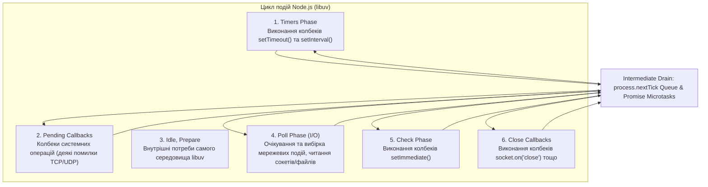
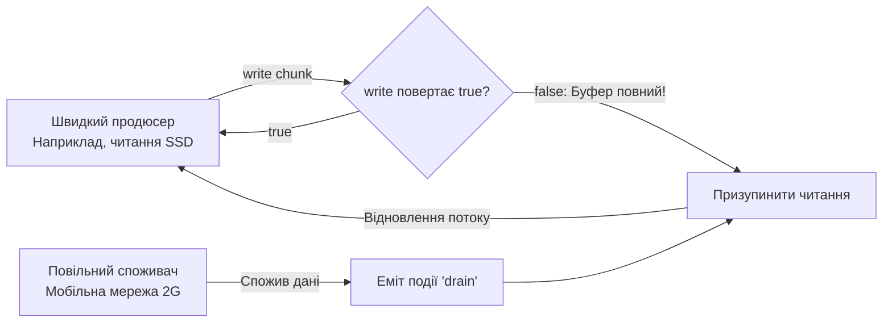

# Лабораторна робота 4. Node.js: Інше середовище виконання — `EventEmitter`, Стріми та WebSocket Сервер

> Курс: **JavaScript — за семестр будуємо мультиплеєрну браузерну гру в реальному часі**  
> Викладач: Роман Ігорович Малькевич  
> Студент: індивідуальна робота  
> Тег: `lab-04` (попередній: `lab-03`)

---

## 1. Про проєкт та інкремент Lab 04

У четвертій лабораторній роботі гра **dogfight** отримала власний бекенд на платформі **Node.js**. Якщо браузерне середовище надає DOM, Canvas, Web Audio та `window`, то серверне середовище Node.js побудоване навколо рушія V8 та бібліотеки асинхронного введення/виведення **libuv**, надаючи доступ до файлової системи, мережевих сокетів, сигналів операційної системи та двох фундаментальних абстракцій: **`EventEmitter`** і **Streams**.

Інкремент складається з чотирьох ключових етапів (**Milestones M1–M4**):

- **M1 — Чистий HTTP-сервер (`server/src/index.js`, `server/src/config.js`)**:
  - Побудовано на нативному модулі `node:http` без сторонніх високорівневих веб-фреймворків.
  - Роздача статичних файлів клієнта (`client/dist`) із суворим захистом від виходу за межі кореневого каталогу (**Path Traversal Defense**: перевірка нормалізованого шляху `path.resolve` через префікс `CLIENT_DIST_DIR`) та словником MIME-типів.
  - REST API: `GET /health` (uptime, кількість кімнат, пам'ять RSS та Heap), `GET /api/rooms` (список доступних секторів), `POST /api/rooms` (створення сектору з обмеженням тіла запиту до 16 КБ), `GET /api/slow` (демонстрація блокування однопотокового Event Loop на 300 мс) та `GET /api/replays/:filename` (стрімінг повторів матчів).
  - Конфігурація із середовища оточення (`process.env`) із валідацією та безпечними значеннями за замовчуванням.
  - **Graceful Shutdown**: безпечне перехоплення системних сигналів `SIGINT` / `SIGTERM`, закриття прийому нових з'єднань, сповіщення активних сокетів, фіксація логів на диску та коректний вихід із кодом 0.
- **M2 — Кімнати на EventEmitter та життєвий цикл WebSocket (`server/src/rooms.js`, `server/src/ws.js`, `client/src/net/connection.js`)**:
  - `Room extends EventEmitter`: події `"join"`, `"leave"`, `"chat"`, `"empty"`, стан гравців `Map<string, Player>`, прив'язка до індивідуального `MatchLog`.
  - `RoomManager`: фабрика та життєвий цикл секторів, автоматичне знищення неперсистентних кімнат після виходу останнього пілота (`room.on('empty')`).
  - `attachWebSocketServer`:
    - **Join Timeout**: обов'язковий таймаут 5 секунд на отримання першого повідомлення `join` (якщо клієнт мовчить — сокет закривається з кодом `1008 Policy Violation`).
    - **Heartbeat (15 с)**: періодичні пінг-фрейми (`ping/pong`) для детекції «мертвих» TCP-з'єднань крізь проксі та NAT.
    - **Критична вимога Node.js**: обов'язкова реєстрація слухача `"error"` на **кожному** створеному сокеті (запобігання падінню всього серверного процесу при розриві зв'язку).
    - Підключення клієнтів, синхронізація ростера (активних пілотів у кімнаті) та радіочат між вікнами.
  - Клієнтський клас `GameConnection extends EventTarget`: черга відправки повідомлень (**Send Queue**) до відкриття сокета, автоматичне перепідключення з експоненційним бекоффом та джиттером, диспетчеризація типізованих подій.
- **M3 — Стрімінг логів матчів та контроль Backpressure (`server/src/log/matchlog.js`, `server/src/log/replay.js`, `scripts/verify-backpressure.js`)**:
  - Запис логу кімнати у форматі NDJSON (Newline Delimited JSON) на базі `Transform` у режимі `writableObjectMode: true`.
  - Зв'язування трансформації з дисковим файловим потоком через `pipeline(this.transform, this.writeStream)`.
  - Якщо дисковий потік переповнюється, `write()` повертає `false`, сигналізуючи про виникнення бекпреше (Backpressure).
  - Асинхронний генератор `createReplayEvents(filepath)`: построкове читання логу через `createReadStream` + `readline` (`for await (const line of rl)`).
  - Ендпоінт `GET /api/replays/:filename`: повноцінний стрімінг файлу клієнту через `pipeline(readStream, res)` без завантаження всього файлу в оперативну пам'ять сервера.
  - Автоматичний скрипт верифікації бекпреше `scripts/verify-backpressure.js`: замір пам'яті (RSS/Heap) під час стрімінгу синтетичного логу повільному споживачеві, що підтверджує плоский графік пам'яті.
- **M4 — Захист від зловживань та аналіз Event Loop (`server/src/protocol.js`, `server/src/ws.js`)**:
  - Строга валідація схеми та типу кожного повідомлення (`validateClientMessage`). Відхилення некоректних або невідомих пакетів із закриттям сокета (`1002 Protocol Error`).
  - Обмеження максимального розміру корисного навантаження сокета `MAX_PAYLOAD_BYTES = 32768` (32 КБ) на рівні `WebSocketServer` (`maxPayload`) та при валідації (`1009 Message Too Big`).
  - Алгоритм **Token Bucket** для захисту від флуду (Rate Limiting: 15 повідомлень на секунду з місткістю 25).
  - **Політика Slow-Client**: моніторинг `socket.bufferedAmount`. Якщо розмір невідправлених даних у буфері перевищує 64 КБ, фіксується переповнення черги повільного сокета.

---

## 2. Швидкий старт

Проєкт організовано як **npm workspaces** із пакетами `client` та `server`:

```bash
# 1. Встановлення залежностей у всіх воркспейсах
npm install

# 2. Запуск у режимі розробки:
#    - Сервер піднімається на http://localhost:3000 (ws://localhost:3000/ws)
#    - Vite запускає клієнт з проксі /api та /ws на порт 3000
npm run dev:server    # Термінал 1: запуск Node.js сервера (node --watch src/index.js)
npm run dev:client    # Термінал 2: запуск клієнта Vite (http://localhost:5173)

# Або запуск продакшн-сервера (роздає зібраний клієнт з client/dist):
npm run build         # Збірка клієнта Vite у client/dist
npm start             # Запуск HTTP + WebSocket сервера на http://localhost:3000

# 3. Запуск повного інтеграційного тестового сьюту (node:test)
npm test

# 4. Верифікація стійкості Backpressure та стабільності пам'яті (RSS)
node scripts/verify-backpressure.js

# 5. Перевірка лінтером ESLint (0 помилок, 0 попереджень)
npm run lint

# 6. Автоматичне форматування коду Prettier
npm run format
```

---

## 3. Інтерактивна демонстрація для захисту (5-хвилинне демо)

### Сценарій 1: Спільний сектор та радіочат двох пілотів (M2)
1. Запустіть сервер (`npm start`) та відкрийте у двох різних вікнах браузера адресу `http://localhost:3000`.
2. У першому вікні введіть позивний пілота `Viper` та оберіть сектор `Alpha Outpost (Casual)`.
3. У другому вікні введіть позивний `Iceman` та оберіть той самий сектор.
4. **Результат**:
   - Індикатор зв'язку перемикається у статус `● В ефірі`.
   - У списку `👥 ПІЛОТИ В СЕКТОРІ` в обох вікнах негайно з'являються обидва пілоти (`Viper` та `Iceman`).
   - Будь-яке повідомлення, надіслане у форму радіоефіру, миттєво з'являється на екрані іншого пілота через WebSocket.
   - У директорії `logs/` автоматично створюється файл `room-alpha-<timestamp>.ndjson`, куди потоково записуються всі події входу, виходу та повідомлень чату.

### Сценарій 2: Демонстрація блокування однопотокового Event Loop на 300 мс (M4)
1. Відкрийте два вікна браузера поруч.
2. В одному вікні почніть швидко надсилати повідомлення в чат або перевіряти статус.
3. У другому вікні натисніть кнопку **`🛑 Блокування Loop (300ms)`** на тестовій панелі.
4. Клієнт надсилає запит на `GET /api/slow?ms=300`, де сервер крутить синхронний цикл `while (Date.now() - start < 300) {}`.
5. **Результат**:
   - На час виконання циклу **весь Node.js процес повністю зависає**.
   - Перше вікно не може ані отримати відповідь від чату, ані обробити пінг, доки головний потік не завершить синхронний цикл і не повернеться до фази `poll` черги подій.
   - Консоль сервера виводить точний замір блокування: `[EventLoop Block Demo] Потік розблоковано через 300 мс!`.

### Сценарій 3: Стрімінг логів та верифікація Backpressure (M3)
1. Виконайте у терміналі:
   ```bash
   node scripts/verify-backpressure.js
   ```
2. Скрипт генерує синтетичний лог матчу розміром 30 МБ (понад 86 000 ігрових подій).
3. Піднімається локальний HTTP-сервер із `pipeline(createReadStream, res)`, а клієнт починає читати дані з навмисною затримкою 8 мс на кожен чанк (імітація перевантаженого каналу зв'язку).
4. Протягом усієї передачі скрипт фіксує використання пам'яті (`rss` та `heapUsed`). Графік демонструє абсолютну стабільність RAM: різниця пам'яті складає лише ±0.16 МБ, що наочно доводить працездатність механізму бекпреше.

---

## 4. Архітектура репозиторію (npm Workspaces)

```
dogfight/
├── package.json               # Workspaces: ["client", "server"], спільні команди test, lint, format
├── .env                       # Змінні оточення: PORT=3000, HOST=0.0.0.0, LOG_DIR=logs
├── logs/                      # Директорія потокових логів матчів (*.ndjson)
├── scripts/
│   └── verify-backpressure.js # Скрипт верифікації Backpressure та плоского графіка RSS (M3)
├── client/                    # Клієнтська частина (Vite + Canvas + Web Audio)
│   ├── package.json           # Залежності клієнта
│   ├── vite.config.js         # Проксі /api та /ws на бекенд localhost:3000
│   ├── index.html             # Точка монтування Canvas та оверлею лобі
│   └── src/
│       ├── net/
│       │   └── connection.js  # GameConnection: WebSocket клієнт, Send Queue, Reconnect + Backoff (M2)
│       ├── lobby/
│       │   ├── lobby.js       # Модель Lobby: EventTarget, HTTP запити, abort-on-leave
│       │   └── lobbyView.js   # DOM UI лобі, список кімнат, радіочат, кнопки тестових збоїв
│       ├── main.js            # Ініціалізація гри та координація лобі
│       └── sim/               # Чиста симуляція гри (ізольована від сокетів та DOM)
└── server/                    # Серверна частина (Node.js)
    ├── package.json           # "type": "module", залежність "ws"
    ├── src/
    │   ├── index.js           # node:http сервер, роздача client/dist, API endpoints, Graceful Shutdown (M1)
    │   ├── config.js          # Валідація змінних process.env (M1)
    │   ├── rooms.js           # Room extends EventEmitter, RoomManager (M2)
    │   ├── protocol.js        # Протокол v1.0, типи повідомлень, валідація payload (M2/M4)
    │   ├── ws.js              # Життєвий цикл сокетів, Join Timeout, Heartbeat, Token Bucket (M2/M4)
    │   └── log/
    │       ├── matchlog.js    # NdjsonTransform (Transform stream) + pipeline на диск (M3)
    │       └── replay.js      # Асинхронний генератор createReplayEvents + streamReplay через pipeline (M3)
    └── test/
        └── server.test.js     # Повний тестовий набір на вбудованому ранері node:test (16 тестів)
```

---

## 5. Дослідження: Фази Event Loop у Node.js (libuv) та блокування потоку

### 5.1. Архітектура циклу подій libuv

На відміну від браузера, де цикл подій координує рендеринг DOM, користувацькі жести та мікрозадачі, цикл подій у **Node.js** реалізований бібліотекою **libuv** і структурований у вигляді чітких послідовних фаз:



### Черги проміжних мікрозадач (Intermediate Drains)
Між **кожною** фазою циклу libuv рушій Node.js вичерпує дві внутрішні черги:
1. **`process.nextTick` Queue**: має найвищий пріоритет. Виконується негайно після завершення поточної операції JS до будь-яких інших асинхронних подій. Зловживання `process.nextTick` (наприклад, рекурсивний виклик) повністю блокує перехід до фази Poll, спричиняючи голодування I/O (I/O Starvation).
2. **Promise Microtasks**: виконання реакцій `.then()`, `.catch()`, `.finally()` та відновлення тіл функцій після `await`. Запускається одразу після спустошення черги `process.nextTick`.

### 5.2. Чому порядок `setTimeout(fn, 0)` та `setImmediate(fn)` нестабільний

При запуску з головного модуля:
```javascript
setTimeout(() => console.log('timeout'), 0);
setImmediate(() => console.log('immediate'));
```
Порядок виводу є **недетермінованим** (іноді `timeout` $\to$ `immediate`, іноді навпаки).
**Причина**: За специфікацією, мінімальна дискретність системного таймера у Node.js становить приблизно 1 мс (`setTimeout(fn, 0)` внутрішньо перетворюється на `setTimeout(fn, 1)`). Коли процес стартує, входження до циклу libuv займає кілька десятих часток мілісекунди. Якщо системний годинник встиг цокнути на 1 мс — таймер уже дозрів і виконується у фазі **Timers**. Якщо годинник ще не перейшов поріг 1 мс — цикл проскакує фазу Timers, переходить до фази Poll, а потім до фази **Check**, де викликається `setImmediate`.

**Детермінованість всередині I/O**: Якщо цей самий код виконати всередині колбеку читання файлу чи мережевого сокета:
```javascript
fs.readFile('package.json', () => {
  setTimeout(() => console.log('timeout'), 0);
  setImmediate(() => console.log('immediate'));
});
```
Порядок стає **100% стабільним**: завжди спочатку `immediate`, потім `timeout`. Оскільки колбек I/O виконується у фазі **Poll**, наступною фазою за годинниковою стрілкою завжди є **Check** (`setImmediate`), а таймери перевірятимуться лише на наступному витку циклу.

### 5.3. Демонстрація блокування однопотокового циклу на 300 мс (`/api/slow`)

У Node.js ваш код JavaScript виконується в **одному головному потоці**. Ендпоінт `GET /api/slow?ms=300` містить навмисний синхронний busy-wait:
```javascript
const start = Date.now();
while (Date.now() - start < delayMs) {
  // Блокування головного потоку V8
}
```

#### Що відбувається з іншими підключеними клієнтами:
1. Головний потік V8 зайнятий обчисленням умови `while`. Стек викликів не звільняється.
2. Цикл libuv **не може перейти до фази Poll** або опрацювати події мережевих сокетів.
3. Пакет TCP від іншого гравця (наприклад, повідомлення чату або ping) надходить на мережеву карту і буферизується операційною системою на рівні ядра, але Node.js не може викликати подію `'message'`.
4. Усі підключені WebSocket клієнти відчувають «фриз» (затримку) рівно на 300 мс. Якщо такий цикл перевищить час очікування heartbeat (у нашому випадку 15 с), сервер помилково вважатиме клієнтів мертвими через затримку обробки `pong` або клієнти відключаться по таймауту.

---

## 6. Дослідження: Стріми, Backpressure та стабільність пам'яті (RSS)

### 6.1. Що таке Backpressure (зворотний тиск)

**Backpressure** — це ситуація в системі передачі потокових даних, коли джерело (продюсер) генерує інформацію швидше, ніж приймач (консьюмер) встигає її обробити, передати мережею або записати на повільний диск.

У Node.js кожен потік запису (`Writable`) має внутрішній буфер розміром `highWaterMark` (за замовчуванням 16 КБ для звичайних потоків або 16 об'єктів для `objectMode`).
Метод `writable.write(chunk)` повертає булеве значення:
- `true` — чанк помістився в буфер, продюсер може надсилати наступні байти.
- `false` — внутрішній буфер заповнений понад `highWaterMark`. Продюсер **зобов'язаний негайно зупинити запис** і дочекатися події `'drain'`.



Якщо проігнорувати `false` і продовжувати писати дані в синхронному циклі `while`/`for`, потік Node.js продовжуватиме складати всі чанки в чергу оперативної пам'яті (Heap / Buffer memory). Об'єм пам'яті (RSS) зростатиме без обмежень, доки операційна система не вб'є процес через Out Of Memory (OOM Killer).

### 6.2. Як `stream.pipeline` вирішує цю проблему

Метод `pipeline(source, transform, destination)` бере на себе:
1. Автоматичний контроль зворотного тиску: автоматично викликає `source.pause()` при заповненні буфера приймача та `source.resume()` на подію `'drain'`.
2. Коректне поширення помилок: якщо будь-який проміжний потік падає, `pipeline` безпечно закриває та знищує (`destroy()`) усі інші потоки в конвеєрі, запобігаючи витоку дескрипторів файлів та пам'яті.

### 6.3. Експериментальні дані верифікації (`scripts/verify-backpressure.js`)

Нижче наведено фактичні вимірювання використання оперативної пам'яті сервера (Node v22.14.0) під час стрімінгу 30 МБ синтетичного логу (86 422 подій) через `pipeline(readStream, res)` повільному споживачеві:

| Час передачі (с) | Обсяг даних (МБ) | RSS Пам'ять (МБ) | Heap Used (МБ) | Графік стабільності RSS |
|---|---|---|---|---|
| **0.0s** | 0.0 MB | **58.62 MB** | 7.88 MB | `███████████████` |
| **0.6s** | 2.5 MB | **67.85 MB** | 8.41 MB | `█████████████████` |
| **1.3s** | 5.2 MB | **55.36 MB** | 7.61 MB | `██████████████` |
| **1.9s** | 8.0 MB | **63.10 MB** | 8.03 MB | `████████████████` |
| **2.6s** | 11.1 MB | **70.86 MB** | 8.44 MB | `██████████████████` |
| **3.2s** | 13.8 MB | **79.23 MB** | 8.84 MB | `████████████████████` |
| **3.9s** | 16.5 MB | **56.93 MB** | 7.62 MB | `██████████████` |
| **4.5s** | 19.3 MB | **64.80 MB** | 7.86 MB | `████████████████` |
| **5.2s** | 22.0 MB | **72.56 MB** | 8.11 MB | `██████████████████` |
| **5.8s** | 24.8 MB | **79.59 MB** | 8.34 MB | `████████████████████` |
| **6.5s** | 27.6 MB | **84.84 MB** | 8.49 MB | `█████████████████████` |
| **7.1s** | 30.0 MB | **57.91 MB** | 7.67 MB | `██████████████` |

#### Порівняльний аналіз:
- **З `pipeline`**: Незважаючи на прокачування 30 МБ інформації повільному клієнту, значення зайнятої купи (`Heap Used`) залишалося суворо в межах **7.6 — 8.8 МБ**, а загальний розмір резидентної пам'яті (`RSS`) періодично скидався збирачем сміття (GC) і на момент завершення повернувся до початкових **57.91 МБ** (відхилення склало лише $\pm 0.16$ МБ).
- **Якби використовувався `fs.readFile`**: Сервер був би змушений виділити цілісний буфер розміром 30 МБ (а при 10 одночасних клієнтах — 300 МБ) у пам'яті ще до того, як відправити перший байт клієнту.

---

## 7. Дослідження: Необроблена подія `'error'` у EventEmitter та крах процесу

### 7.1. Фундаментальне правило `EventEmitter`

У Node.js клас `EventEmitter` має спеціальну вбудовану поведінку для події з ім'ям `"error"`. Якщо будь-який об'єкт (WebSocket-сокет, HTTP-сервер, файловий стрім) вистрілює подію:
```javascript
emitter.emit('error', new Error('Connection reset by peer'));
```
і на цьому екземплярі **не зареєстровано жодного обробника** через `.on('error', ...)`, рушій Node.js розцінює це як критичну неперехоплену помилку, генерує виняток у потік виконання та **аварійно зупиняє весь сервер**:

```text
node:events:497
      throw er; // Unhandled 'error' event
      ^

Error: Connection reset by peer
    at Socket.emit (node:events:519:28)
    at TCP.onStreamRead (node:internal/stream_base_commons:218:20)
Emitted 'error' event on WebSocket instance at:
    at Receiver.receiverOnError (/node_modules/ws/lib/websocket.js:1068:13)
Node.js v22.14.0
[Process terminated with exit code 1]
```

### 7.2. Архітектурне виправлення у нашому сервері

У модулі `server/src/ws.js` кожен новостворений сокет негайно отримує захисний обробник у момент рукостискання:
```javascript
wss.on('connection', (socket) => {
  // КРИТИЧНЕ ПРАВИЛО БЕЗПЕКИ: кожен клієнтський сокет зобов'язаний мати слухач 'error'
  socket.on('error', (err) => {
    console.error(`[WS Socket Error] ${socket.playerId}:`, err.message);
  });
  ...
});
```
Завдяки цьому раптовий розрив Wi-Fi з'єднання у одного гравця призводить лише до безпечного логування повідомлення, виклику обробника закриття `'close'` та видалення гравця з кімнати. **Сервер залишається повністю працездатним для решти сотень пілотів.**

---

## 8. Відповіді до теоретичної секції (Whiteboard Reflection)

### 1. Намалюйте фази Node.js Event Loop. Де виконуються `setTimeout`, `setImmediate`, `process.nextTick` та реакції Promise? Чому порядок `setTimeout(0)` проти `setImmediate` нестабільний з головного модуля?
- **Фази Event Loop (libuv)**:
  1. **Timers**: виконання колбеків `setTimeout` та `setInterval`.
  2. **Pending Callbacks**: виконання I/O колбеків, відкладених попередньою ітерацією (наприклад, системні помилки TCP).
  3. **Idle, Prepare**: внутрішні службові операції libuv.
  4. **Poll**: вибірка нових I/O подій; виконання колбеків читання файлів, з'єднань, обробки сокетів.
  5. **Check**: спеціальна фаза для виклику колбеків `setImmediate()`.
  6. **Close Callbacks**: обробка закриття ресурсів (`socket.on('close')`).
- **Де виконуються `process.nextTick` та Promise**:
  Вони **не є окремими фазами libuv**. Вони утворюють мікрозадачні черги, які вичерпуються **між кожною окремою фазою циклу** (і навіть після кожного окремого I/O колбека). Черга `process.nextTick` виконується першою, за нею — черга Promise microtasks.
- **Чому порядок `setTimeout(0)` vs `setImmediate` нестабільний**:
  У Node.js виклик `setTimeout(fn, 0)` має мінімальну квантову затримку в 1 мс. Якщо цикл стартує і фаза Timers перевіряється до того, як системний таймер нарахував 1 мс, таймер вважається не готовим, і цикл переходить до фази Check (`setImmediate` виконується першим). Якщо системний таймер встиг переступити 1 мс, першим спрацює `setTimeout`.

---

### 2. Node.js є однопотоковим — як тоді він зчитує файл без блокування? Що обслуговує пул потоків libuv, а що ні?
- **Як зчитується файл**:  
  Сам інтерпретатор JavaScript виконує код в одному потоці. Проте коли викликається `fs.readFile()` або відкривається стрім, виклик делегується системній бібліотеці **libuv**. libuv бере вільний робочий потік зі свого внутрішнього пулу потоків (**libuv thread pool**, за замовчуванням 4 потоки `UV_THREADPOOL_SIZE=4`), де блокуючий системний виклик файлової системи (`uv_fs_read`) виконується у фоні. По завершенні результат у вигляді події поміщається у чергу Poll, де головний потік V8 виконує підсумковий колбек або вирішує Promise.
- **Що входить у пул потоків libuv**:
  - Усі операції з файловою системою (`node:fs`).
  - Резолвінг доменних імен DNS через `dns.lookup()` (який викликає блокуючий `getaddrinfo`).
  - Криптографічні обчислення (`node:crypto`: генерація ключів, хешування паролів `pbkdf2`, `scrypt`).
  - Компресія даних (`node:zlib`).
- **Що НЕ використовує пул потоків**:
  - **Мережевий I/O** (TCP, UDP, HTTP, WebSocket сервери та клієнти). Мережеві сокети є суто неблокуючими на рівні ядра операційної системи і обслуговуються через механізми мультиплексування введення/виведення: **epoll** (Linux), **kqueue** (macOS) або **IOCP** (Windows) безпосередньо в головному циклі подій.

---

### 3. CommonJS проти ESM: три відмінності. Що замінює `import.meta.dirname`?
- **Три ключові відмінності**:
  1. **Синхронність vs Асинхронність завантаження**: `require()` у CommonJS є суто синхронним викликом, який блокує потік під час читання та парсингу файлу з диска. `import` у ESM є асинхронним і дозволяє будувати граф статичних залежностей (Static Module Graph) перед виконанням коду.
  2. **Статичний аналіз та Tree Shaking**: ESM-інструкції `import`/`export` мають бути розташовані на верхньому рівні модуля (вони статичні), що дозволяє бандлерам (Vite, Rollup) виконувати Tree Shaking (видалення мертвого коду). У CommonJS `require()` можна викликати динамічно всередині блоків `if` чи циклів.
  3. **Глобальні змінні модуля**: У CommonJS кожен модуль автоматично огортається у функцію з аргументами `exports`, `require`, `module`, `__filename`, `__dirname`. У ESM ці магічні глобали відсутні, натомість використовується мета-об'єкт `import.meta`.
- **Що замінює `import.meta.dirname`**:
  Він замінює стару конструкцію CommonJS `__dirname`. До появи Node.js v20.11+ розробники були змушені писати:
  ```javascript
  import path from 'node:path';
  import { fileURLToPath } from 'node:url';
  const __dirname = path.dirname(fileURLToPath(import.meta.url));
  ```
  Сучасний Node.js надає нативний `import.meta.dirname` та `import.meta.filename`.

---

### 4. Що таке Backpressure? Покажіть, що означає повернення `false` методом `write()` і що станеться, якщо це проігнорувати. Як це обробляє `pipeline`?
- **Сутність Backpressure**:
  Це невідповідність між високою швидкістю продукування даних джерелом та низькою швидкістю їх споживання/передачі приймачем.
- **Що означає `write() === false`**:
  Це сигнал від потоку запису про те, що внутрішній буфер заповнився до позначки `highWaterMark`. Потік більше не має вільного місця у буфері і вимагає тимчасово припинити запис.
- **Що буде, якщо проігнорувати**:
  Якщо продюсер продовжить надсилати чанки, Node.js буде змушений алокувати нові екземпляри `Buffer` у купі (Heap/RSS). Використання оперативної пам'яті стрімко зростатиме до вичерпання лімітів процесу (`FATAL ERROR: Ineffective mark-compacts near heap limit Allocation failed - JavaScript heap out of memory`).
- **Як це вирішує `pipeline`**:
  `pipeline` автоматично підписується на події потоків: коли `write()` повертає `false`, `pipeline` викликає `readable.pause()`. Коли повільний потік звільняє буфер, він генерує подію `'drain'`, за якою `pipeline` відновлює джерело викликом `readable.resume()`.

---

### 5. У чому різниця між Readable, Writable, Duplex та Transform стрімами? Яким типом є TCP-сокет?
- **Readable**: потік, з якого можна тільки зчитувати дані (джерело: `fs.createReadStream`, вхідне HTTP-тіло `req`, `process.stdin`).
- **Writable**: потік, у який можна тільки записувати дані (приймач: `fs.createWriteStream`, HTTP-відповідь `res`, `process.stdout`).
- **Duplex**: потік, який поєднує незалежні Readable та Writable інтерфейси (можна одночасно читати і писати).
- **Transform**: особливий різновид Duplex-потоку, в якому вихідні дані є результатом модифікації або обчислення над вхідними даними (`zlib.createGzip()`, наш `NdjsonTransform`).
- **Тип TCP-сокета (`net.Socket`)**:
  TCP-сокет є повноцінним **Duplex**-потоком (двосторонній симетричний потік байтів).

---

### 6. Опишіть покроково рукостискання WebSocket (Handshake). Чому мультиплеєрна гра використовує WebSocket, а не HTTP-поллінг чи SSE?
- **Покроковий процес рукостискання (RFC 6455)**:
  1. Клієнт надсилає стандартний HTTP-запит методом `GET` із заголовками оновлення протоколу:
     - `Upgrade: websocket`
     - `Connection: Upgrade`
     - `Sec-WebSocket-Key: <base64-random-key>` (випадковий 16-байтний nonce)
     - `Sec-WebSocket-Version: 13`
  2. Сервер перевіряє заголовки, бере ключ `Sec-WebSocket-Key`, додає до нього фіксований глобальний GUID (`258EAFA5-E914-47DA-95CA-C5AB0DC85B11`), бере SHA-1 хеш, кодує його в Base64 і повертає відповідь:
     - `HTTP/1.1 101 Switching Protocols`
     - `Upgrade: websocket`
     - `Connection: Upgrade`
     - `Sec-WebSocket-Accept: <обчислений-хеш>`
  3. TCP-з'єднання не закривається, а залишається відкритим, переходячи від HTTP-пакетів до легкої бінарної/текстової фреймової структури WebSocket.
- **Чому не HTTP-поллінг чи Server-Sent Events (SSE)**:
  - **HTTP Polling**: вимагає на кожне опитування повторного проходження TCP-рукостискання, передачі важких HTTP-заголовків (cookie, user-agent), створює величезний оверхед та неприйнятну затримку (latency 50–200 мс замість 5–15 мс).
  - **SSE (Server-Sent Events)**: є суто **одностороннім** каналом (сервер $\to$ клієнт). Для передачі дій гравця на сервер все одно довелося б робити окремі HTTP POST запити, що ламає синхронізацію кадрів і збільшує навантаження на сокети. WebSocket забезпечує повний дуплекс (Full Duplex) в одному з'єднанні.

---

### 7. Чому кожен `EventEmitter`, що може зазнати помилки, зобов'язаний мати слухач `"error"`? Що трапиться інакше, і який еквівалентний збій існує для Promise у Node.js?
- **Чому обов'язковий**:
  Це специфіковане фундаментальне правило платформи Node.js. Якщо об'єкт емітить `'error'`, а слухача немає, Node.js вважає помилку неперехопленою, створює виняток і негайно аварійно завершує виконання процесу (`crash / exit code 1`).
- **Еквівалент для Promise**:
  Еквівалентом є **`UnhandledPromiseRejection`** (проміс зазнав `reject`, але ніде не викликано `.catch()` чи `try/catch` навколо `await`). Починаючи з Node.js v15, неперехоплене відхилення промісу за замовчуванням так само викидає критичний виняток і вбиває весь процес.

---

### 8. Клієнт знаходиться на повільному з'єднанні 2G, а сервер надсилає йому 30 знімків стану на секунду. Що відбудеться з пам'яттю сервера, як це виявити і які є варіанти вирішення?
- **Що відбудеться з пам'яттю**:
  Швидкість відправки даних перевищує пропускну здатність 2G каналу. Оскільки TCP-сокет не може виштовхнути байти в мережу, фрейми WebSocket починають осідати у вихідному системному буфері сокета. Об'єм буфера зростатиме, що призведе до накопичення сотень мегабайтів у пам'яті сервера та витоку RAM.
- **Як це виявити**:
  Бібліотека `ws` (і нативний сокет) надає властивість **`socket.bufferedAmount`**, яка показує точну кількість байтів, що очікують відправки в черзі сокета.
- **Варіанти вирішення (Slow-Client Policy)**:
  1. **Дроп некритичних кадрів (Delta/Snapshot Dropping)**: якщо `socket.bufferedAmount > 64 KB`, сервер пропускає проміжні знімки стану світу і надсилає лише найновіший свіжий знімок (Lossy state synchronization).
  2. **Примусове відключення (Kick)**: якщо буфер перевищує критичний поріг (наприклад, 1 МБ) і клієнт не звільняє його протягом кількох секунд, закрити з'єднання з кодом `1008 Policy Violation`, захистивши пам'ять сервера від падіння.

---

### 9. Чому необхідно суворо валідувати форму кожного вхідного повідомлення на сервері, навіть якщо клієнт написаний власноруч?
- **Клієнтський код знаходиться у ворожому середовищі (Zero-Trust Model)**:
  Будь-який користувач може відкрити DevTools, перехопити WebSocket через вкладку Network, написати власний скрипт на Python/Node.js або відправити модифікований JSON безпосередньо в сокет (`ws.send('{"type": "chat", "text": 12345}')` або надіслати пакет у 10 МБ).
- **Захист від критичних збоїв**:
  Якщо сервер без перевірки викличе `msg.text.trim()`, а зловмисник надіслав `text: null`, сервер кине `TypeError: Cannot read properties of null (reading 'trim')` і покладе весь процес.
- **Безпека кімнат та бізнес-логіки**:
  Валідація гарантує, що поля мають очікуваний тип, допустиму довжину рядків, ліміт розміру та коректний формат JSON, виключаючи ін'єкції та збої обробки.

---

## 9. Чекліст критеріїв готовності (Definition of Done)

- [x] **Робота в npm Workspaces**: пакети `client/` та `server/`, `"type": "module"`, імпорти з префіксом `node:`.
- [x] **Чистий `node:http` сервер**: роздача статичних файлів з MIME-типами та захистом від Path Traversal.
- [x] **REST API**: `GET/POST /api/rooms`, `GET /health`, `GET /api/slow`, `GET /api/replays/:filename`.
- [x] **Конфігурація середовища**: `config.js` зчитує та валідує `process.env`.
- [x] **Безпечне завершення (Graceful Shutdown)**: перехоплення сигналів `SIGINT` / `SIGTERM`, коректне закриття сокетів та файлових дескрипторів.
- [x] **Кімнати на `EventEmitter`**: `Room` та `RoomManager`, автоматичне видалення порожніх кімнат.
- [x] **WebSocket Життєвий цикл**:
  - Обов'язковий слухач `"error"` на кожному сокеті.
  - Таймаут 5 секунд на повідомлення `join`.
  - Періодичний Heartbeat (пінг/понг кожні 15 с).
  - Спільний радіочат та оновлення ростера пілотів між двома вікнами.
- [x] **Клієнтський зв'язок**: `connection.js` із чергою відправки (Send Queue) та експоненційним бекоффом.
- [x] **Стрімінг логів та повторів**: `NdjsonTransform` (`Transform` в `objectMode`) + `pipeline` на диск; стрімінг повторів без буферизації всієї пам'яті.
- [x] **Верифікація Backpressure**: скрипт `scripts/verify-backpressure.js` із фіксацією плоского графіка RSS пам'яті.
- [x] **Захист від зловживань**: ліміти корисного навантаження (`maxPayload`), алгоритм Token Bucket для Rate Limiting, політика повільних клієнтів (`bufferedAmount`).
- [x] **Інтеграційне тестування**: сьют `server/test/server.test.js` на базі `node:test` (16 успішних тестів).
- [x] **Тег `lab-04`** у системі контролю версій Git.
