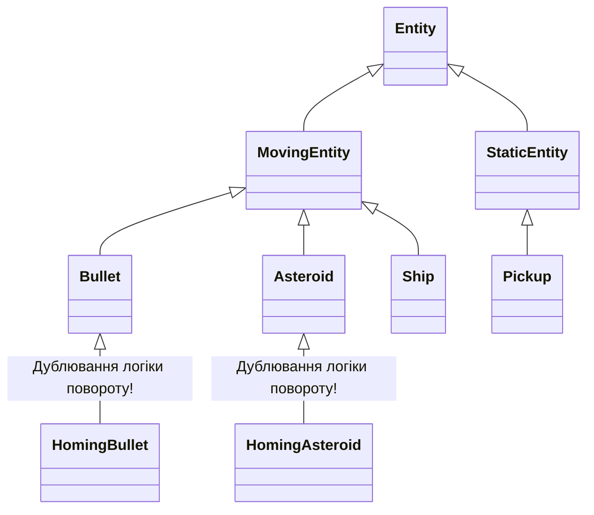

# Лабораторна робота 2. Об’єкти, прототипи та `this`: модель сутностей

> Курс: **JavaScript — за семестр будуємо мультиплеєрну браузерну гру в реальному часі**  
> Викладач: Роман Ігорович Малькевич  
> Студент: індивідуальна робота  
> Тег: `lab-02` (попередній: `lab-01`)

---

## 1. Про проєкт та інкремент Lab 02

У другій лабораторній роботі гру **dogfight** розширено від одиночного корабля до повноцінного симулятора космічного бою з безліччю динамічних сутностей:
- **`Vector2`**: математичний вектор із гарантією незмінності (pure methods), де кожна операція повертає новий екземпляр без мутації аргументів.
- **Базовий клас `Entity`**: інкапсуляція приватного лічильника `#id` (`static #nextId = 1`), позиції, швидкості, радіуса колізійного кола та прапорця `alive`.
- **Один рівень успадкування**: `Ship extends Entity`, `Bullet extends Entity`, `Asteroid extends Entity`, `Pickup extends Entity`, `Explosion extends Entity`. Ієрархія класів не перевищує один рівень.
- **Менеджер сутностей `World` поверх `Map<number, Entity>`**: підтримка відкладеного прибирання (deferred sweep), протокол ітерування `[Symbol.iterator]` та генератор вибірки `*ofKind(kind)`.
- **Система колізій коло–коло**: винесена в окрему замінювану систему (функція `resolveCollisions` із відокремленим детектором пар `findCollisionsNaive`), що забезпечує легкий перехід на просторове хешування (Spatial Hash) у Lab 07.
- **Приватні поля**: рівень міцності корабля `#hp` інкапсульовано всередині `Ship` та надано через публічний геттер `get hp()`.
- **Стрільба та відродження**: постріли з носа корабля з урахуванням власної швидкості, система частинок для вибухів, відродження корабля через 2.0 секунди у безпечній точці та підрахунок очок.
- **Композиція замість глибокої ієрархії**: реалізовано поведінку самонаведення (**homing**), що приєднується як до куль, так і до астероїдів, а також систему підбирачів (**pickup**: щит, швидкострільність, самонавідні ракети, ремонт).
- **Аналіз та виправлення багу втрати контексту `this`**: практичне дослідження 4 правил `this` при передачі методів об'єкта як функцій зворотного виклику.

---

## 2. Швидкий старт

```bash
# Встановлення залежностей
npm install

# Запуск локального dev-сервера (Vite)
npm run dev

# Перевірка лінтером ESLint (без помилок і попереджень)
npm run lint

# Автоматичне форматування коду Prettier
npm run format

# Продакшн-білд
npm run build
```

---

## 3. Керування та інтерактивний захист (5-хвилинне демо)

### Основне ігрове керування:
- **`W` / `ArrowUp`** — векторна тяга маршового двигуна (прискорення корабля).
- **`A` / `ArrowLeft`** — поворот ліворуч.
- **`D` / `ArrowRight`** — поворот праворуч.
- **`Space`** або **Клік лівою кнопкою миші** — стрільба з носа корабля.
- **`Escape`** — пауза / відновлення ігрового циклу.

### Гарячі клавіші для демонстрації вимог Lab 02:
- **`K`** — **Демонстрація багу втрати `this` та його виправлення**:
  - *Крок 1*: наївний виклик відокремленого методу `const rawFire = ship.fire; rawFire()`. У термінал та на HUD виводиться перехоплений `TypeError: Cannot read properties of undefined` (правило Default Binding).
  - *Крок 2*: виправлений виклик через явний `.bind(ship)` або стрілочну функцію `() => ship.fire(world)`. У термінал та на HUD виводиться успішний статус пострілу.
- **`H`** — **Спавн астероїда-мисливця (Homing Asteroid via Composition)**:
  - Створює астероїд із прикріпленим компонентом `createHoming({ targetKind: 'ship' })`. Астероїд отримує червону ауру і динамічно переслідує корабель гравця.
- **`P`** — **Спавн випадкового бонусу (Pickup via Composition)**:
  - Створює стаціонарний пульсуючий бонус (щит `🛡`, швидкострільність `⚡`, ракети `🎯` або ремонт `+`).
- **`1` / `2` / `3`** — збережені експерименти Lab 01 (100ms блокуючий цикл, `setInterval`, змінний крок).

---

## 4. Архітектура сутностей

```
src/
├── main.js              # Ініціалізація Canvas, World, Ship, слухачів та ігрового циклу
├── loop.js              # Fixed timestep цикл симуляції з інтерполяцією
├── input.js             # Замикання клавіатури з методами isDown, justPressed, consume
├── style.css            # Стилізація canvas на весь екран
├── sim/
│   ├── vector.js        # Vector2: незмінні чисті математичні методи (add, sub, scale, rotate)
│   ├── entity.js        # Базовий Entity: приватний статичний #nextId, приватний #id, pos, vel
│   ├── ship.js          # Ship extends Entity: приватне #hp, get hp(), fire(world), respawn
│   ├── bullet.js        # Bullet extends Entity: TTL, damage, підтримка homing-компонента
│   ├── asteroid.js      # Asteroid extends Entity: процедурні вершини, поділ, підтримка homing
│   ├── pickup.js        # Pickup extends Entity: колідує, але не є кораблем, ефект через компонент
│   ├── explosion.js     # Explosion extends Entity: система частинок з обмеженим часом життя
│   ├── components.js    # Компоненти композиції: createHoming, createPickupEffect
│   ├── collision.js     # Коло-коло колізії: findCollisionsNaive (O(n²)) та resolveCollisions
│   ├── world.js         # Керуючий клас World поверх Map<number, Entity>, ofKind, deferred sweep
│   └── arena.js         # Обгортання меж екрана (wrap) та захист інтерполяції (hideWrapForLerp)
└── render/
    ├── canvas.js        # Масштабування для екранів з високим DPR
    └── draw.js          # Рендер зірок, сітки, корабля з щитом, астероїдів, частинок і HUD
```

### Принципи побудови сутностей:
1. **Незмінний `Vector2`**:
   Методи `add`, `sub`, `scale`, `normalize`, `rotate` не мутують поточний вектор або аргументи, а повертають `new Vector2(...)`. Це запобігає прихованим мутаціям стану, коли спільний вектор передається кільком системам.
2. **Інкапсуляція ідентифікатора**:
   `Entity` використовує приватне статичне поле `static #nextId = 1` та приватне поле `#id = Entity.#nextId++`. Зовнішній доступ можливий лише для читання через `get id()`. Підробити або змінити ID сутності ззовні синтаксично неможливо.
3. **Один рівень успадкування**:
   Жоден клас не перевищує глибину `extends Entity`. Усі спеціалізовані поведінки (самонаведення, ефекти підбирання предметів) підключаються через композицію.
4. **Сховище сутностей на базі `Map<number, Entity>`**:
   `World` зберігає сутності за числовим ID. Видалення здійснюється у 2 фази:
   - Фаза 1: позначення `entity.alive = false` (відкладене видалення, щоб уникнути мутації колекції під час її проходу).
   - Фаза 2 (Sweep): наприкінці `World.step` усі сутності з `!entity.alive` видаляються з `Map`.
5. **Генератор `*ofKind(kind)`**:
   Дозволяє ліниво ітерувати сутності потрібного типу (`for (const bullet of world.ofKind("bullet"))`), не створюючи проміжних масивів у heap і не навантажуючи збирач сміття (Garbage Collector).

---

## 5. Дослідження та виправлення багу `this`

### Чотири правила визначення `this` (за спаданням пріоритету):

1. **`new` binding**:
   При виклику `new FunctionName()` створюється новий порожній об'єкт, з'єднується з прототипом, і `this` прив'язується до цього нового екземпляра.
2. **Явне зв'язування (Explicit binding)**:
   Примусове встановлення контексту через `fn.call(obj, ...args)`, `fn.apply(obj, [args])` або постійна фіксація через `fn.bind(obj)`.
3. **Неявне зв'язування (Implicit binding)**:
   Виклик через об'єкт-власник у місці виклику: `obj.fn()`. Значенням `this` стає об'єкт зліва від крапки.
4. **Зв'язування за замовчуванням (Default binding)**:
   Виклик без контексту: `fn()`. У нестрогому режимі `this` стає `window` / `globalThis`. **У суворому режимі (`"use strict"`), включно з усіма ES-модулями та тілами класів ES6, `this` дорівнює `undefined`**.

### Виняток: Стрілочні функції (Arrow Functions)
Стрілочні функції **не мають власного `this`**. Вони захоплюють `this` лексично з навколишнього скоупу на момент свого створення (як звичайна змінна в замиканні). Метод `.bind()` для стрілочних функцій не має сили.

---

### Суть проблеми у грі:

При наївному підключенні методу стрільби до слухача подій:
```javascript
// ПОМИЛКА: передається посилання на метод, а не його виклик
window.addEventListener('click', ship.fire);
```
Браузер зберігає посилання на функцію `fire`. Коли виникає подія, браузер викликає цю функцію як звичайний колбек або з `this = window`/`target element`. Оскільки `class Ship` завжди виконується у суворому режимі:
- `this` стає `undefined` (або посиланням на об'єкт `window`/`HTMLElement`).
- Вираз `this.pos` чи `this.#hp` намагається прочитати поле у `undefined`.
- Рушій V8 викидає фатальну помилку:  
  `TypeError: Cannot read properties of undefined (reading '#hp')` або `Cannot read private member #hp from an object whose class did not declare it`.

---

### Три альтернативні варіанти виправлення:

| Варіант виправлення | Приклад синтаксису | Переваги | Недоліки |
|---|---|---|---|
| **1. Стрілочна функція-обгортка** | `window.addEventListener('click', (e) => ship.fire(world))` | Максимально читабельний код, лексичний `this`, легко передати додаткові аргументи (`world`, координати). | Створює новий функціональний об'єкт при кожній реєстрації; для видалення через `removeEventListener` потрібно зберігати посилання на обгортку. |
| **2. Явний `Function.prototype.bind()`** | `window.addEventListener('click', ship.fire.bind(ship, world))` | Повертає жорстко прив'язану функцію, контекст неможливо випадково перезаписати ззовні. | Створює новий екземпляр зв'язаної функції в пам'яті; складніший для читання синтаксис. |
| **3. Поле класу зі стрілочною функцією** | `class Ship { fire = (world) => { ... } }` | Метод уже має жорстко прив'язаний `this` у кожного інстанса; можна передавати просто як `ship.fire`. | Порушує прототипну оптимізацію: замість одного спільного методу в `Ship.prototype`, кожна копія сутності створює власне поле в пам'яті (критично для тисяч куль). |

**Обраний підхід у проєкті**: варіант 1 для обробників введення (`(e) => ship.fire(world)`), оскільки метод `fire` залишається у прототипі `Ship.prototype` і не дублюється в пам'яті, а виклик через стрілку дозволяє безпечно прокидати екземпляр `world`.

---

## 6. Дизайн-запис: Композиція проти глибокої ієрархії спадкування

### Проблема, яку вирішує композиція (M4)

У грі реалізовано дві спеціалізовані механіки:
1. **Самонаведення (`homing`)**:
   - Самонавідна ракета (похідна від кулі, цілиться в найближчий астероїд).
   - Астероїд-мисливець (похідний від перешкоди, переслідує корабель гравця).
2. **Підбирач бонусів (`pickup`)**:
   - Стаціонарна або повільно дрейфуюча сутність у космосі, яка має колізійне коло і відлік часу життя, але **не є кораблем** і не стріляє.

---

### Як виглядала б класична ієрархія класів (Inheritance):

Спроба реалізувати ці механіки через спадкування призводить до структурного колапсу:



#### Чому це ламається:
1. **Проблема ромбоподібного спадкування (The Diamond Problem)**:  
   Якщо створити клас `HomingEntity extends MovingEntity`, то від кого має спадкуватися `HomingBullet`? Від `Bullet` чи від `HomingEntity`? У JavaScript підтримується лише одиночне спадкування (`single inheritance`). Довелося б або повністю продублювати весь код наведення (розрахунок кута, нормалізація різниці, доворот) у класах `HomingBullet` та `HomingAsteroid`, або створювати штучні проміжні класи, які ламають логіку інших підкласів.
2. **Закам'яніла ієрархія (Rigid Hierarchy)**:  
   Якщо завтра з'явиться стаціонарна турель, що наводиться на гравця, вона не зможе успадкувати `MovingEntity`.
3. **Забруднення базових класів**:  
   Часто розробники здаються і переносять прапорці `isHoming`, `isPickup`, `target` у базовий `Entity`. Це перетворює базовий клас на «божественний об'єкт» (God Object), де 90% полів не використовуються звичайними сутностями.

---

### Реалізація через композицію (Обраний підхід)

Сутність розглядається як контейнер поведінок. Поведінка самонаведення інкапсульована у чистій фабричній функції:

```javascript
// src/sim/components.js
export function createHoming({ targetKind = 'asteroid', turnRate = 4.5, speed = 380 }) {
  let currentTargetId = null;
  return {
    name: 'homing',
    update(entity, dt, world) {
      // Автономний пошук цілі targetKind у world та коригування entity.angle і entity.vel
    }
  };
}
```

#### Переваги композиційного підходу:
- **Універсальність**: компонент приєднується одним рядком `entity.homing = createHoming(...)`. Він працює однаково ефективно як на `Bullet`, так і на `Asteroid`.
- **Ізоляція**: логіка векторного розрахунку цілі знаходиться в одному місці (`components.js`), без дублювання коду.
- **Динамічність**: сутність може набувати поведінки в рантаймі (наприклад, гравець підбирає бонус і його звичайні кулі стають самонавідними на 10 секунд).
- **Готовність до мережевої синхронізації (Lab 05)**: дані сутності залишаються плоскими структурами без глибоких прототипних ланцюгів, що критично важливо для серіалізації в бінарний буфер або JSON.

---

## 7. Відповіді до секції Reflection (Підготовка до захисту)

### 1. Назвіть 4 правила визначення `this` у порядку їхнього пріоритету. Що таке `this` у `setTimeout(ship.fire, 100)`? Наведіть три варіанти виправлення та один недолік кожного.
- **Порядок пріоритетів**:
  1. `new Binding`: `new Ship()` $\to$ `this` вказує на щойно створений екземпляр.
  2. `Explicit Binding`: `fn.call(obj)`, `fn.apply(obj)`, `fn.bind(obj)` $\to$ `this` суворо дорівнює переданому об'єкту.
  3. `Implicit Binding`: `obj.fn()` $\to$ `this` дорівнює об'єкту зліва від крапки в точці виклику.
  4. `Default Binding`: самостійний виклик `fn()` $\to$ `undefined` у строгому режимі / класах, або `globalThis` у нестрогому.
- **Що таке `this` у `setTimeout(ship.fire, 100)`?**  
  `this` дорівнюватиме `undefined` (оскільки класи ES6 неявно мають `"use strict"`). Під час спрацьовування таймера функція викликається без лівого контексту. Виклик викличе `TypeError`.
- **Три виправлення та їхні недоліки**:
  1. `setTimeout(() => ship.fire(world), 100)` — *недолік*: створення додаткового функціонального об'єкта в купі на кожен виклик таймера.
  2. `setTimeout(ship.fire.bind(ship, world), 100)` — *недолік*: створює зв'язану копію функції, менш гнучко змінювати аргументи на льоту.
  3. `fire = (world) => { ... }` як поле класу — *недолік*: метод створюється заново на кожному екземплярі об'єкта, не потрапляє у спільний прототип `Ship.prototype`, що збільшує використання пам'яті.

---

### 2. Чому стрілочні функції ігнорують `.bind()`? Де вони доречні, а де є поганим вибором для спільного методу?
- **Чому ігнорують**:  
  За специфікацією ECMAScript стрілочні функції не мають внутрішнього слоту `[[ThisMode]] = global/lexical` у традиційному сенсі і взагалі не мають власного зв'язування `this`. Вони звертаються до `this` так само, як до звичайної змінної у зовнішній лексичній області видимості (Lexical Environment). Операція `.bind()` може змінити лише функцію з власним динамічним `this`.
- **Де доречні**:
  - У колбеках обробників подій (`addEventListener`, таймери `setTimeout`, методи масивів `.map()`, `.filter()`).
  - У замиканнях, де потрібно гарантовано зберегти контекст зовнішнього класу чи фабрики.
- **Де є помилкою**:
  - У ролі методів на рівні класу, які діляться між тисячами сутностей (наприклад, `update` у куль). Якщо оголосити метод як поле-стрілку `update = (dt) => {}`, він створюється в кожному екземплярі сутності індивідуально, витрачаючи пам'ять купи замість одного посилання в `Entity.prototype`.

---

### 3. Чому `Map` кращий за звичайний об'єкт `{}` як сховище сутностей? Назвіть три конкретні причини.
1. **Типізація ключів без приведення до рядка**:  
   У звичайному об'єкті `{}` будь-який ключ автоматично конвертується в рядок (`obj[1]` стає `obj["1"]`). У `Map` числові ідентифікатори (`id = 1`) зберігаються як справжні числа без зайвого рядкового парсингу.
2. **Відсутність конфліктів із прототипом**:  
   Об'єкт `{}` успадковує властивості `Object.prototype` (`toString`, `constructor`, `valueOf`). Якщо ID сутності співпаде з `"constructor"`, звичайний об'єкт видасть функцію-конструктор замість сутності. `Map` позбавлений прототипних ключів.
3. **Швидкодія та прямий доступ до розміру**:  
   `Map` оптимізовано рушієм V8 для частих операцій додавання та видалення елементів (висока динаміка куль та уламків). Властивість `.size` повертає точну кількість за $O(1)$ без потреби викликати `Object.keys(obj).length` ($O(n)$).

---

### 4. Доведіть перевагу композиції над спадкуванням на прикладі самонавідної кулі та самонавідного астероїда.
- Якщо використовувати спадкування, для надання поведінки самонаведення довелося б створити або дублюючі класи `HomingBullet extends Bullet` та `HomingAsteroid extends Asteroid`, скопіювавши всю формулу тригонометричного повороту, або створити спільний клас `HomingEntity`.
- Проте створення `HomingEntity` ламає структуру: куля має властивості снаряда (власник, TTL, пошкодження), а астероїд — властивості перешкоди (розмір, маса, поділ на уламки). Спроба схрестити їх через `extends` призводить до ромбоподібного глухого кута.
- У композиційному варіанті компонент `homing` є незалежним об'єктом із методом `update(entity, dt, world)`. Він оперує виключно публічними векторними полями `pos`, `vel`, `angle`. Ми можемо додати його до будь-якої сутності одним присвоєнням, забезпечивши принцип єдиної відповідальності (Single Responsibility Principle) та повторне використання коду.

---

### 5 (Stretch). Прототипний ланцюжок для `const s = new Ship()`: що робить `s.update` крок за кроком?
1. Коли виконується `s.update(dt, world)`:
2. Рушій V8 перевіряє власні властивості об'єкта `s` (`s.hasOwnProperty('update')`). Якщо метод визначено як звичайний метод класу `Ship`, його немає серед власних полів екземпляра.
3. Рушій переходить за внутрішнім посиланням `[[Prototype]]` до `Ship.prototype`.
4. Якщо в `Ship.prototype` є власний метод `update`, він викликається з `this = s`.
5. Якщо всередині викликається `super.update(dt, world)`, пошук починається з прототипу `Ship.prototype`, тобто з `Entity.prototype`.
6. Метод знаходиться в `Entity.prototype.update` і виконується в контексті екземпляра `s`.
7. Якби методу не було в `Entity.prototype`, пошук пішов би до `Object.prototype`, а далі до `null`, після чого було б викинуто помилку `s.update is not a function`.

---

### 6 (Stretch). Що саме робить оператор `new`? Реалізація через функцію
Оператор `new`:
1. Створює новий порожній об'єкт `{}`.
2. Встановлює прототип цього об'єкта рівним властивості `Constructor.prototype`.
3. Викликає функцію-конструктор із цим новим об'єктом як `this` (`Constructor.apply(obj, args)`).
4. Якщо конструктор повернув власний об'єкт, повертає його; інакше повертає щойно створений об'єкт.

```javascript
function customNew(Constructor, ...args) {
  const instance = Object.create(Constructor.prototype);
  const result = Constructor.apply(instance, args);
  return (typeof result === 'object' && result !== null) ? result : instance;
}
```

---

## 8. Чекліст виконаних вимог (Definition of Done)

- [x] **`Vector2`**: чисті незмінні методи (`add`, `sub`, `scale`, `normalize`, `rotate`, `dot`, `dist`, `fromAngle`), що не мутують вхідні дані.
- [x] **`Entity`**: базовий клас із приватним статичним лічильником `#nextId`, приватним `#id` та числовим геттером `get id()`.
- [x] **`Ship extends Entity`**: один рівень успадкування; приватне міцність `#hp` та публічний `get hp()`.
- [x] **`World`**: зберігання сутностей у `Map<number, Entity>`, підтримка `for...of` через `[Symbol.iterator]`, лінивий генератор `*ofKind(kind)`.
- [x] **Відкладене видалення (Deferred sweep)**: позначення `alive = false` у процесі кадру та очищення колекції наприкінці `World.step()`.
- [x] **Стрільба та кулі**: виліт снарядів з носа корабля з урахуванням вектора швидкості, обмеження за часом життя (TTL).
- [x] **Колізії коло–коло**: окрема замінювана система `resolveCollisions()` з чистим детектором `findCollisionsNaive()`.
- [x] **Відродження та візуальні ефекти**: детонація корабля та астероїдів через систему частинок `Explosion`, респаун корабля через 2.0 секунди у безпечній точці, відображення очок і здоров'я на HUD.
- [x] **Композиція**:
  - Самонаведення (`createHoming`): працює на ракетах та на астероїдах-мисливцях (`[H]`).
  - Бонуси (`createPickupEffect`): стаціонарні бонуси (`[P]`), які не є кораблями.
  - Дизайн-запис у README порівнює спадкування та композицію.
- [x] **Баг `this`**: детально задокументовано 4 правила, розібрано випадок `ship.fire`, додано інтерактивний тест (`[K]`).
- [x] Відповіді на всі питання секції Reflection готові до усного захисту.
- [x] Створено репозиторій та зафіксовано git-тег `lab-02`.
