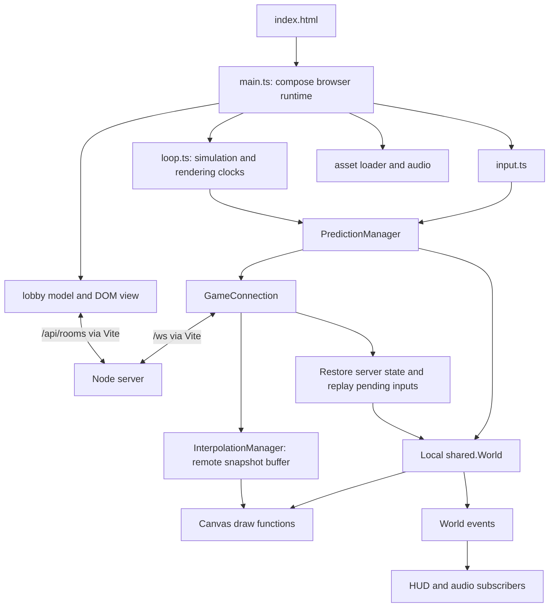
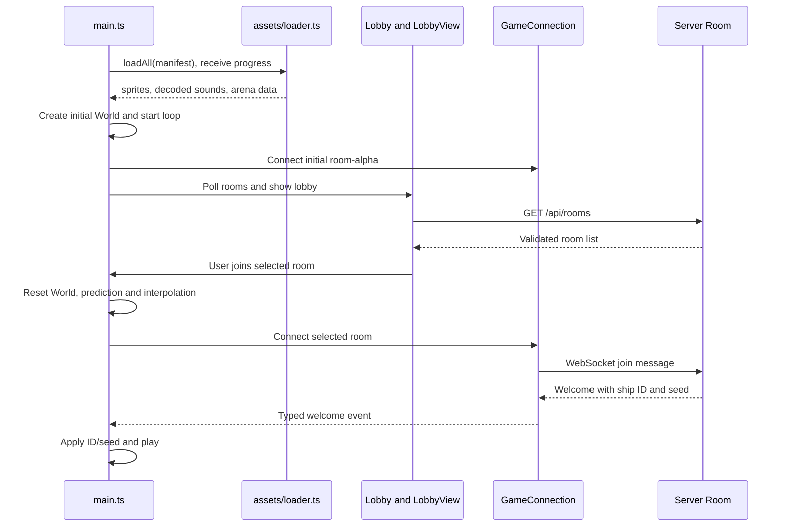
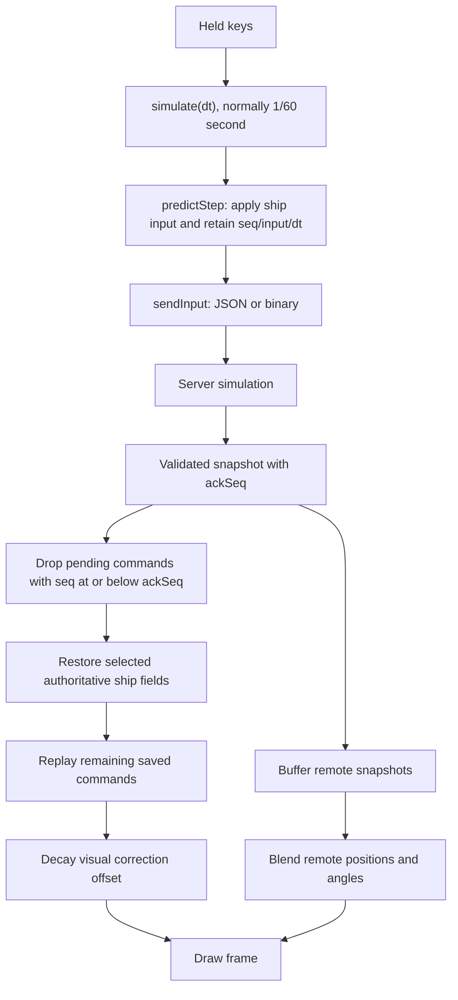

# Client architecture and file guide

This package runs in the browser. It owns input, Canvas drawing, lobby/HUD presentation, asset loading, audio, and the predicted local view of a match. The server owns the authoritative match result.

This guide describes the current TypeScript implementation. Historical lab commits have different file layouts. See the [server guide](../server/ARCHITECTURE.md) and [shared guide](../shared/ARCHITECTURE.md) for the other packages.

## Package relationships



Client and server import the same shared code but create separate objects in separate processes. A client World is a local simulation, not a reference to server memory.

## Startup and joining a room



The lobby model owns requests, selection and polling. The view owns DOM listeners, roster/chat display and its diagnostic buttons. HTTP failures can fall back to the static room list; that fallback does not create a working multiplayer backend.

## One input and one returned snapshot



The browser loop accumulates elapsed time and advances fixed simulation steps before drawing. Normal scheduling uses requestAnimationFrame; busy-wait, interval and variable-step modes are teaching experiments.

The current simulate function calls both predictStep and world.step. Rendering combines the local World with network entities, and reconciliation restores selected ship fields rather than replacing the whole World. Shared rules alone therefore do not establish identical live worlds. Remote interpolation uses about 66 ms of arrival-time history; it handles arena wrapping and shortest-path angles. The renderer receives alpha, but currently displays the local ship through prediction smoothing rather than alpha-based blending of saved ship states.

## File-by-file walkthrough

Use these checkboxes as a code presentation checklist. Paths are relative to client/.

### Entry, configuration and input

- [ ] [index.html](index.html) — HTML entry page and module script that boots the client.
- [ ] [package.json](package.json) — Browser workspace, shared dependency, and Vite/build/typecheck commands.
- [ ] [tsconfig.json](tsconfig.json) — Inherits strict root settings and adds DOM libraries and bundler resolution.
- [ ] [vite.config.js](vite.config.js) — Development port and HTTP/WebSocket proxies to the backend.
- [ ] [src/main.ts](src/main.ts) — Composition root: startup, room World creation, subscriptions, simulate/render callbacks, clicks and teaching shortcuts.
- [ ] [src/loop.ts](src/loop.ts) — Accumulator loop, frame-time clamp, metrics, start/stop and scheduler experiments.
- [ ] [src/input.ts](src/input.ts) — Encapsulates held/newly pressed keys and browser listener cleanup.
- [ ] [src/dom.ts](src/dom.ts) — DOM query helper and conversion of unknown errors into messages.
- [ ] [src/style.css](src/style.css) — Canvas and overlay presentation.
- [ ] [src/type-contracts.ts](src/type-contracts.ts) — Compile-time examples checked with expected errors for invalid payloads, brands and readonly data; not a gameplay feature.

### Resources and presentation

- [ ] [src/assets/loader.ts](src/assets/loader.ts) — Manifest validation, fetch/status handling, cancellation, retry/backoff, resource decoding, parallel loading and progress.
- [ ] [src/assets/benchmark.ts](src/assets/benchmark.ts) — Compares sequential and parallel resource-loading durations.
- [ ] [src/audio/audio.ts](src/audio/audio.ts) — Audio context unlock, sound buffers/playback and World event subscription cleanup.
- [ ] [src/render/canvas.ts](src/render/canvas.ts) — Canvas context setup, device-pixel-ratio sizing and resize handling.
- [ ] [src/render/draw.ts](src/render/draw.ts) — Background/starfield/grid and local/remote entity drawing with sprite/fallback rendering.
- [ ] [src/render/loadingScreen.ts](src/render/loadingScreen.ts) — Canvas progress/error screen during startup.
- [ ] [src/ui/hud.ts](src/ui/hud.ts) — World event subscriptions, score/feed/effects, timers and Canvas HUD.
- [ ] [src/ui/netgraph.ts](src/ui/netgraph.ts) — DOM telemetry/chart and controls for codec, prediction, reconciliation, interpolation and network experiments.

### Lobby and network

- [ ] [src/lobby/lobby.ts](src/lobby/lobby.ts) — Typed lobby model: validate rooms, select room/name, poll, cancel stale requests, join and leave.
- [ ] [src/lobby/lobbyView.ts](src/lobby/lobbyView.ts) — Lobby DOM, room cards, roster/chat, connection status and failure-gallery controls.
- [ ] [src/net/bus.ts](src/net/bus.ts) — Re-exports shared Bus and maps server message variants to typed client event payloads.
- [ ] [src/net/connection.ts](src/net/connection.ts) — WebSocket lifecycle/reconnect, validation, binary/JSON transport, message dispatch, pings, bandwidth metrics and network experiment configuration.
- [ ] [src/net/prediction.ts](src/net/prediction.ts) — Local input sequence/queue, prediction, acknowledgement pruning, restore/replay and visual smoothing.
- [ ] [src/net/interpolation.ts](src/net/interpolation.ts) — Remote snapshot history, delayed sampling and wrap-aware position/angle interpolation.

### Public files

Vite serves public files at the site root. The manifest names resources to load; loaded arena metadata is not automatically applied to every physics constant.

- [ ] [public/api/rooms.json](public/api/rooms.json) — Static room-list fallback for the lobby.
- [ ] [public/assets/manifest.json](public/assets/manifest.json) — Resource URLs and sprite frame rectangles.
- [ ] [public/assets/arena.json](public/assets/arena.json) — Arena metadata loaded through the manifest.
- [ ] [public/assets/sprites.png](public/assets/sprites.png) — Sprite atlas for ships, asteroids, bullets and pickups.
- [ ] [public/assets/sounds/laser.wav](public/assets/sounds/laser.wav) — Firing sound.
- [ ] [public/assets/sounds/hit.wav](public/assets/sounds/hit.wav) — Impact sound.
- [ ] [public/assets/sounds/explosion.wav](public/assets/sounds/explosion.wav) — Explosion sound.
- [ ] [public/assets/sounds/pickup.wav](public/assets/sounds/pickup.wav) — Pickup sound.
- [ ] [public/assets/dogfight-two-players.gif](public/assets/dogfight-two-players.gif) — Recorded demonstration media, outside the manifest gameplay resources.
- [ ] [public/favicon.svg](public/favicon.svg) — Browser icon asset.
- [ ] [public/icons.svg](public/icons.svg) — SVG icon asset.

## Run and inspect

From the repository root, install with npm.cmd ci. Keep these running in separate terminals:

```powershell
npm.cmd run dev:server
```

```powershell
npm.cmd run dev --workspace=client -- --host localhost --port 5173 --strictPort
```

Open the page from another terminal:

```powershell
Start-Process 'http://localhost:5173'
```

- [ ] Follow startup in main.ts, then input through prediction and connection.
- [ ] Join the same room in two windows and compare local response with remote movement.
- [ ] Use DevTools Network to inspect HTTP requests and /ws frames.
- [ ] Use 4 for Netgraph and compare codec bytes and corrections under latency.
- [ ] Run npm.cmd run typecheck --workspace=client and npm.cmd run build from the root.

node_modules/ contains installed dependencies; dist/ is generated build output. They are excluded from the authored-file reference. Runtime and migration tests live in the server package; compile-time client examples live in type-contracts.ts.

