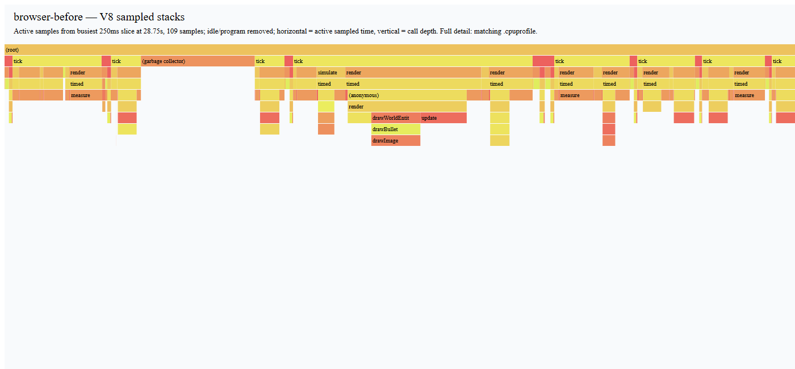
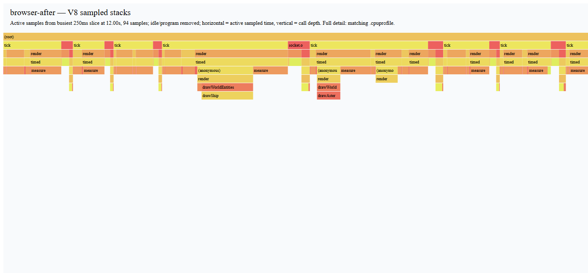
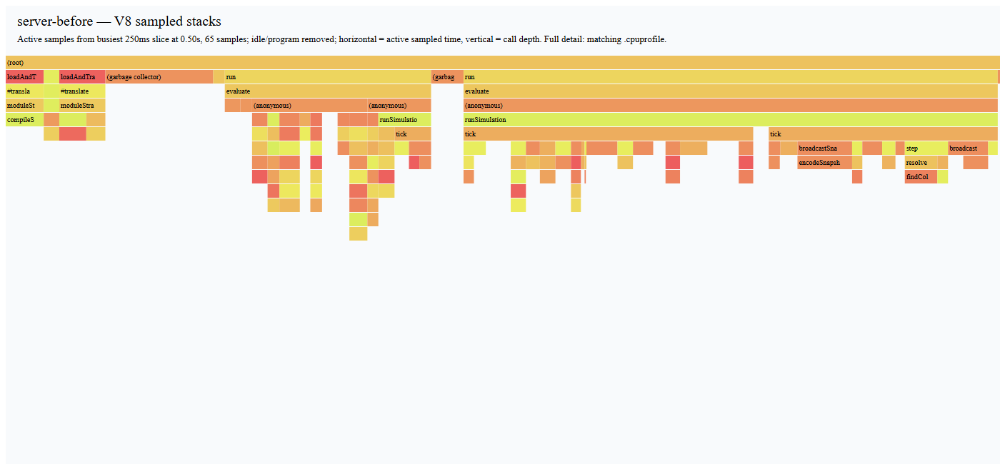
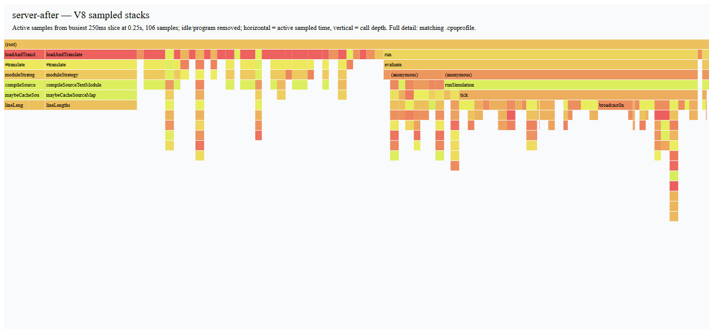
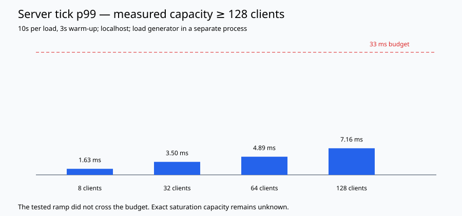

# Lab 07 report: tests, engines and measured performance

Completed locally on 2026-11-02. The [visible TODO](../TODO.md) tracks submission status. GitHub Actions is configured but its remote result is unverified until the changes are pushed.

## Verification and behavior

Root Vitest runs 102 tests across server, client and shared, preserving all 55 earlier regression tests. Seven fast-check properties cover input quantization, snapshot size, arbitrary garbage, structured invalid frames, 1,000-step arena bounds, parser field mutations and drag. Properties use seed 7007. Fake timers exercise the accumulator and WebSocket heartbeat. Reconciliation assertions use independently calculated positions and verify input immutability. Collision tests explicitly document discrete fast-bullet tunneling; continuous collision detection is outside this lab.

Shared coverage: **92.45% lines**, **91.51% statements**, **90.62% functions**, 77.21% branches. CI enforces 85% for lines, statements and functions; branch coverage is reported, not thresholded. Typecheck, recommended type-checked ESLint (including no-floating-promises), build and the two-context Playwright test pass locally. The E2E test joins through the lobby, verifies both rosters, observes the actual remote interpolation output move within 500 ms, and types a chat message through the UI.

The longer capture exposed and fixed a stale-socket close race. Replaced sockets cannot schedule reconnects or update the new session. Keyboard shortcuts now let chat/name fields receive ordinary text. Bot removal/insertion uses monotonic IDs to avoid overwriting a surviving bot. Malformed binary entity fields consistently produce RangeError.

## Method and environment

Intel(R) Core(TM) i5-9600KF CPU @ 3.70GHz; 6 logical cores; 15.9 GiB RAM; win32/x64; Node v22.14.0; Chromium 156.0.8078.4; headless 1200×800. These are local measurements, not cross-machine guarantees. Run captures sequentially, with other workloads idle. The stored before run overlapped a short verification run; this and the single before/after pair limit causal conclusions about small timing differences.

Server: deterministic seed 7007, eight bots with heavy shooting, 300 warm-up ticks, 60 seconds at approximately 30 Hz. A fake open recipient for each bot exercises snapshot encoding/fan-out without socket cost. Node --cpu-prof includes startup and idle time; the matching JSON holds individual post-warm-up tick samples. Load testing below adds real sockets.

Browser: eight server bots shoot continuously, one browser pilot thrusts and fires, five-second warm-up, 30-second sample window. User Timing instruments simulate/render/decode/reconcile only when diagnostics is enabled. Entries are cleared after observation. Allocation sampling uses a separate following five-second window, so sampling cannot cause collections inside the frame/GC window. V8 sampling is statistical; allocator bytes are estimates, not a census. Trace and CPU profiler overhead remain in frame measurements. The seed is fixed, but wall-clock join timing, scheduling, visuals and GC are not deterministic.

The four performance changes are preserved in [optimizations.patch](performance/optimizations.patch). They were measured together; the table does not attribute the entire difference to any individual change. Baseline and final variants share the correctness fixes, instrumentation, workload and unminified profiling build. The patch also records error normalization in the decoder, added after the baseline capture.

## Before and after

| Metric (ms unless stated) | Before |  After |
| ------------------------- | -----: | -----: |
| Frame interval p50        | 16.700 | 16.700 |
| Frame interval p95        | 16.700 | 16.700 |
| Frame interval p99        | 16.800 | 16.800 |
| Render span p99           |  1.500 |  2.800 |
| Simulation span p99       |  0.400 |  0.400 |
| Decode span p99           |  0.400 |  0.500 |
| Reconciliation span p99   |  0.200 |  0.100 |
| GC count                  |     56 |     45 |
| Major GC count            |     39 |     20 |
| GC total duration         | 73.027 | 46.979 |
| Server tick p50           |  0.199 |  0.179 |
| Server tick p95           |  0.304 |  0.505 |
| Server tick p99           |  0.504 |  0.808 |

The strict zero-major-GC / frame-p99-under-16.7-ms target is **not achieved**. The measured frame interval is quantized by Chromium's roughly 60 Hz scheduling and 0.1-ms timestamp resolution: a nominal 16.667-ms cadence produces 16.7/16.8-ms samples even when render work takes much less time. Raw traces show major collections finalizing incremental marking via a task; they still occur, so this report makes no GC-free claim. User Timing itself is a major sampled native cost. This is the measured limit of this instrumented headless run, not proof that the physical display or an uninstrumented session performs identically. Server percentile differences are small absolute values and noisy; use the recorded figures rather than assuming every percentile improved.

Allocation hot spots (five-second sample windows):

| Variant | Allocator (self)        | Estimated MiB |
| ------- | ----------------------- | ------------: |
| before  | drawStarfield           |          4.93 |
| before  | getInterpolatedEntities |          3.69 |
| before  | decodeSnapshot          |          3.50 |
| after   | decodeSnapshot          |          3.99 |
| after   | drawWorldEntities       |          3.93 |
| after   | (anonymous) :3          |          3.19 |

Top sampled self-time functions, excluding idle/program pseudo-frames:

| Variant | Function               | Self ms over capture |
| ------- | ---------------------- | -------------------: |
| before  | measure :0             |             1572.939 |
| before  | mark :0                |              197.606 |
| before  | update                 |              131.113 |
| after   | measure :0             |             1286.462 |
| after   | mark :0                |              185.556 |
| after   | (garbage collector) :0 |               43.436 |

Server application self-time (startup/native/idle frames excluded):

| Variant | Function           | Self ms over profile |
| ------- | ------------------ | -------------------: |
| before  | encodeSnapshot     |               17.723 |
| before  | broadcastSnapshots |               14.851 |
| before  | tick               |               10.867 |
| after   | broadcastSnapshots |               15.698 |
| after   | update             |                9.614 |
| after   | (anonymous)        |                9.240 |

Optimizations justified by these profiles:

- Cache each star's rgba color at creation instead of formatting 160 strings per frame. drawStarfield was the largest named baseline allocator.
- Pool interpolation render records and their position objects, reuse the result array and ID lookup, and delete records when entities disappear. Tests verify identity reuse, seam interpolation and cache cleanup. Bullet pooling was not added because bullets were not a leading sampled allocator; pooling retained immutable vectors would also complicate the simulation contract.
- Update Netgraph at 10 Hz instead of rewriting its DOM every rendered frame. update and updateCodecBadge appeared in baseline CPU samples. Input and rendering still run at their original rates.
- Encode the binary entity body once per server tick, then give each recipient an independent buffer with its own ackSeq. The baseline server CPU profile shows encodeSnapshot ahead of collision detection. A regression test retains both buffers and checks that later acknowledgements cannot mutate earlier sends. Collision detection was retained because the eight-bot profile did not justify replacing it with a spatial hash.

These screenshots render a real sampled stack timeline for active samples in the busiest 250-ms slice (idle/program samples removed for readability). Open the matching .cpuprofile files in DevTools for the complete timeline and bottom-up view. Raw browser traces are gzip-compressed JSON; decompress before importing into DevTools. The game screenshots also record the rendered bot workload.

## Replay worker: go for bulk replay processing

The subsystem decodes a packed binary replay (uint32 length + snapshot per frame) into a frame/entity count and coordinate checksum. Each of five runs processes 1,000 frames × 64 nonzero-position ships, 1,556,000 bytes. Main and worker results must match, and the transferred sender buffer must detach. Packing is charged separately on the main thread.

| Median across five runs                   |      ms |
| ----------------------------------------- | ------: |
| Pack replay on main thread                |   0.700 |
| Synchronous decode on main thread         |  79.700 |
| Cold worker round trip (includes startup) | 117.400 |
| Warm clone round trip                     |  71.300 |
| Warm clone postMessage cost               |   0.600 |
| Warm transfer round trip                  |  72.600 |
| Warm transfer postMessage cost            |   0.000 |
| Worker transfer decode                    |  69.500 |

Keep the optional transferable replay worker: it removes the synchronous decode task from the main thread, even when cold startup increases total completion time. Warm round-trip minus worker decode is the observed messaging/scheduling overhead; transfer postMessage itself is near the clock's resolution. Clone retains the source buffer; transfer detaches it. The helper is an experiment callable from diagnostics, not a new replay UI. It is not used for small per-tick inputs where message latency would affect responsiveness.

## Real WebSocket capacity ramp

Separate load-generator process; real ws clients send movement/fire at 30 Hz; three-second warm-up then ten seconds per point. Server RSS and interval event-loop utilization exclude the generator process. Traffic counts application payload bytes received by clients plus their sent inputs, not TCP/WebSocket framing. Benchmark-only rooms bypass the ordinary API's 32-player creation cap; that production limit remains unchanged.

| Clients | Tick p99 ms | Server ELU | RSS MiB | Payload MB/s | Still connected |
| ------: | ----------: | ---------: | ------: | -----------: | --------------: |
|       8 |       1.627 |       4.0% |    85.9 |         0.32 |             8/8 |
|      32 |       3.499 |       5.0% |    93.2 |         2.49 |           32/32 |
|      64 |       4.886 |       7.5% |   103.8 |         7.01 |           64/64 |
|     128 |       7.160 |      13.2% |   106.9 |        18.23 |         128/128 |

Measured capacity is **at least 128 clients** for this workload and loopback network. The tested ramp did not cross 33 ms; exact saturation N and the eventual bottleneck are unknown. Traffic grows strongly because every client receives the world; this is a scaling concern, not evidence that bandwidth was saturated. The local benchmark cannot establish internet capacity or long-term memory stability.

## Reproduce

Run npm ci, then npm run test:coverage, npm run typecheck, npm run lint, npm run build and npm run test:e2e. Install Chromium first with npx playwright install chromium. Run npm run bench:suite -- after for the complete sequential experiment; npm run bench:load and npm run bench:browser -- after also work independently in fresh processes. SECONDS can shorten individual browser/simulation/load scripts for smoke checks; the suite defaults to 60/30/10 seconds. Regenerate this report with node scripts/report-lab07.js after measurements and coverage exist.

To reproduce the baseline, use a scratch checkout of lab-07, apply git apply -R docs/performance/optimizations.patch, build, then run npm run bench:suite -- before. This changes only the recorded performance variant and decoder error normalization. Do not reverse the patch over unrelated local edits. The baseline produces its own raw samples rather than reusing the saved numbers.

## Whiteboard reflections

1. Source is parsed, compiled to Ignition bytecode and profiled; frequently used stable code can progress through available optimizing tiers (such as Maglev/TurboFan). Unexpected shapes/types or failed assumptions can deoptimize it. Ship movement consistently uses numeric Vector2 coordinates; assigning a string instead would invalidate that assumption. This is an illustrative deopt example, not a claim that a particular deopt was observed in the capture.
2. A shape describes property layout. An inline cache can specialize a property read for a small set of shapes; many layouts require more general lookup. Constructors initialize fields consistently. Pooled interpolation records are replaced when the entity kind changes, and star colors are initialized at construction rather than attached in the hot loop.
3. Generational GC exploits the fact that many objects die young. A scavenge copies surviving young objects; old-generation collection traverses a larger retained graph and can require longer work. A particle that survives promotion becomes old-generation work, unlike a short-lived temporary. Actual pause behavior depends on incremental/concurrent collection and workload.
4. The largest named baseline allocator was drawStarfield; caching its static strings removes those repeated allocations. Interpolation was another major allocator and now reuses render records. Pooling costs retained memory, reset discipline and aliasing risk; stale pooled records must not survive entity disappearance.
5. Typed arrays give dense numeric storage with fixed element representation and less object allocation. They lose convenient per-record object identity/methods and flexible heterogeneous fields; growth and deletion need explicit capacity/free-list management. The wire/replay experiments use ArrayBuffer and typed views without rewriting the whole simulation.
6. Structured clone copies data and preserves ownership; transfer moves a transferable buffer and detaches the sender; SharedArrayBuffer shares bytes and needs synchronization plus cross-origin isolation in browsers. The measured replay transfer keeps the main thread free, while cold worker startup is a visible total-latency cost.
7. Example tests pin down specific behavior (the seam, shield damage and known acceleration); properties explore broad domains. The input property decodes an encoded generated command and checks seq/tick/flags exactly and turn within 0.000501. fast-check shrinks failing inputs toward a small reproducible counterexample; a fixed seed makes reruns repeatable.
8. A forgotten Promise rejection can escape an event handler and become an unhandled rejection in Node. Typed lint exposed asynchronous HTTP/signal callbacks and room destruction. The code now observes rejections through catches and a synchronous HTTP boundary, rather than silently leaving a request unresolved.
9. Capacity is a measured lower bound, not an invented exact N: all 128 clients remained connected below the tick budget. The eight-bot CPU profile justified reducing repeated encoding. Neither that small profile nor the unsaturated load ramp proves the eventual capacity bottleneck; identifying it requires extending the ramp and profiling near the budget crossing.
