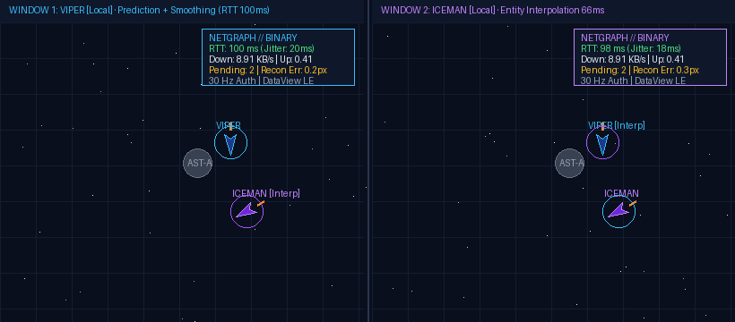

# Лабораторна робота 6. TypeScript: спільні контракти, строга типізація та перевірка мережевих даних

> Archived lab reports and historical measurements. For the current setup and architecture guide, see [README.md](../README.md).

> Audit correction (2026-11-03): these are historical reports, not independently verified raw measurements. The binary angle formula and parts of the protocol diagram below do not match the encoder; the actual angle factor is 1000 (0.001 rad steps). The existing two-player GIF is a generated 2.16-second illustration, not gameplay footage. See the [all-labs audit](labs-audit.md#lab-05--predictionnetwork-protocol) and [current codec](../shared/src/codec/binaryCodec.ts) before using the archived claims in a defense.

> Курс: **JavaScript — за семестр будуємо мультиплеєрну браузерну гру в реальному часі**  
> Викладач: Роман Ігорович Малькевич  
> Студент: індивідуальна робота  
> Тег: `lab-06` (попередній: `lab-05`)

---

## Lab 06 — виконання M1–M4

Завдання: [lab-06.md](lab-06.md). Теорія: [lab-06.notes.md](lab-06.notes.md).
Клієнт, сервер і спільна симуляція перенесені на TypeScript. Усі три пакети
успадковують `strict`, `noUncheckedIndexedAccess` та `verbatimModuleSyntax` із
`tsconfig.base.json`. Сервер запускається через `tsx`, клієнт збирається Vite.

| Етап | Реалізація |
|---|---|
| M1 | Єдина симуляція в `shared/src/sim/`, readonly-вектори й знімки, бренди `EntityId`, `Tick`, `Seq` |
| M2 | Zod-схеми → виведені типи → Result-парсери в `shared/src/protocol/protocol.ts`; JSON/Binary `Codec`; перевірки довжини, версії, діапазонів і прапорців |
| M3 | Повна TS-міграція; typed `Room` і `Bus<GameEvents>`; типізовані події World; Zod-конфігурація; CI перевіряє типи, lint, тести й збірку |
| M4 | Рішення щодо UI-фреймворку, знайдені проблеми та пояснення трьох типів нижче |

### Запуск і перевірка

Потрібні Node.js 22 та npm. Із кореня репозиторію:

```bash
npm ci
npm run typecheck
npm run lint
npm test
npm run build

# Два окремі термінали:
npm run dev:server
npm run dev:client
```

Відкрийте адресу Vite у двох вкладках, приєднайтеся до однієї кімнати та
перевірте рух і постріли. У Netgraph (`N`) можна перемикати JSON/Binary і
додавати затримку. Для автоматичної перевірки двох клієнтів:

```bash
node --import tsx scripts/verify-dogfight.js
node --import tsx scripts/benchmark-codecs.js
```

GitHub Actions виконує ті самі основні перевірки після `npm ci`.
Локально перевірено: typecheck, lint, production build, усі 55 тестів,
Lab 03 regression script і headless-бій двох клієнтів зі штучною затримкою.
`server/test/migration.test.js` порівнює точний знімок після 1000 кроків із
реалізацією за тегом `lab-05`; окремо перевіряється детермінізм двох світів.
У сценарії використовуються ID від алокатора: старий hard-coded `100`
міг збігтися з ID наступної сутності та приховував перезапис корабля.
Захист від таких колізій тепер перевіряється окремим тестом.
`client/src/type-contracts.ts` перевіряє відхилення неправильних payload,
змішаних брендів і мутацій readonly-даних через `@ts-expect-error`.

### What TypeScript found

- `Canvas.getContext('2d')` може повернути `null`: ініціалізація тепер перевіряє контекст перед рендерингом (`client/src/render/canvas.ts`).
- `Event.target` може бути `null` або не бути HTML-елементом: обробники звужують його через `instanceof`, перш ніж читати DOM-властивості (`client/src/ui/netgraph.ts`).
- `Map.get()` і індексація масивів можуть повернути `undefined`: пошук власника кулі та обробка черги повідомлень перевіряють результат перед використанням (`shared/src/sim/collision.ts`, `client/src/net/connection.ts`).
- Рендер-функції з параметрами, виведеними лише з `null`, не приймали завантажені зображення: явні типи ресурсів описують як зображення, так і fallback (`client/src/render/draw.ts`).
- Приведення результату `JSON.parse` до типу не перевіряє мережеві дані: тепер вхід має тип `unknown` і проходить Zod перед dispatch. Це виправлення межі runtime, яке сам компілятор зробити не може.

### Три найцікавіші типи

1. **`ClientMessage = z.infer<typeof ClientMessageSchema>`.** Схема одночасно
   перевіряє JSON під час виконання і створює TS-тип. Поле `type` відрізняє
   `join`, `input`, `chat` та інші варіанти; після перевірки цього поля
   компілятор знає доступні властивості. `assertNever` виявляє пропущений
   варіант у диспетчері.
2. **`EntityId`, `Tick`, `Seq`.** У JavaScript це числа; у TypeScript вони мають
   різні бренди. `world.get(asTick(1))` не компілюється, хоча `1` є числом.
   Конструктори `asEntityId`/`asTick`/`asSeq` перевіряють діапазони через Zod,
   а не приховують помилки небезпечним приведенням типу.
3. **`Bus<E>` та `GameEvents`.** Mapped type перетворює union повідомлень на
   таблицю «назва → payload». Параметр `K extends keyof E` зв'язує назву події
   з `E[K]`: `emit('status', {status: 'connected'})` дозволений, а `'flying'`
   замість стану з'єднання — помилка компіляції. Той самий Bus обслуговує
   типізовані події симуляції.

### Рішення щодо UI-фреймворку

Лобі та HUD залишені на vanilla DOM із типізованим Bus. Для двох невеликих
панелей поточний поділ моделі й відображення достатній; додавання React,
Vue або Svelte збільшило б залежності та складність збірки без потрібної
для цієї роботи функціональності. Canvas, фізика та ігровий цикл залишаються
незалежними від UI. Перевага фреймворку при подальшому розширенні —
декларативні компоненти й автоматичне оновлення складного інтерфейсу.

### Завершення та регресії

Регресійні тести охоплюють повторне використання ID після 65 535 створень,
збереження зайнятих ID, відхилення некоректних бінарних кутів, коректний
код закриття браузерного WebSocket і rate limiting обох форматів.
Керувальні повідомлення мають окремий ліміт `RATE_LIMIT_PER_SEC` (15/с),
ввід — `INPUT_RATE_LIMIT_PER_SEC` (120/с, мінімум 60/с), щоб підтримувати
звичайний ігровий цикл. Конфігурація читається з оточення процесу;
`.env` автоматично не завантажується.

У TS-коді немає типу `any` або небезпечних приведень `as SomeType`.
Залишено чотири `as const` для таблиць літералів і бінарної специфікації;
кожне має коментар із поясненням. Це const assertions, які зберігають
точні значення, а не підмінюють перевірку вхідних даних.

- [x] M1: strict toolchain і спільна типізована симуляція.
- [x] M2: єдині схеми/типи протоколу та перевірки обох кодеків.
- [x] M3: клієнт і сервер під strict; типізовані події; CI.
- [x] M4: рішення щодо фреймворку, знайдені проблеми, три типи.
- [x] Регресії та порівняння детермінованої симуляції з Lab 5.
- [x] Локальний тег здачі: `lab-06`.

Нижче збережено звіт Lab 5 як опис мережевої архітектури та попередніх
експериментів; наведені там виміри стосуються попереднього інкременту.

---

## Демонстрація: Мультиплеєрний догфайт двох гравців пліч-о-пліч (100 мс затримки, 30 Hz)



> *"The client is in the hands of the enemy."*  
> — кожен розробник мультиплеєрних ігор рано чи пізно стикається з цією аксіомою.

---

## 1. Про проєкт та інкремент Lab 05

У п'ятій лабораторній роботі гра **dogfight** здійснила фундаментальний стрибок від локального клієнта та базового лобі (Lab 01–04) до **повноцінної мультиплеєрної мережевої гри в реальному часі** з авторитетним сервером.

Головний виклик комп'ютерних мереж у динамічних іграх — це подолання фізичного піка затримки (RTT 60–120 мс). Якщо керувати кораблем безпосередньо через серверні команди без передбачення, корабель реагує із запізненням на весь RTT, роблячи гру абсолютно некерованою («гумове керування»). Якщо ж дозволити клієнту транслювати власні координати, виникає розходження симуляцій через похибки чисел із плаваючою комою, а будь-який користувач може відкрити DevTools і миттєво телепортуватися.

Розв'язанням цієї дилеми є класична індустріальна архітектура (Gabriel Gambetta / Valve Source Engine / Overwatch GDC): **авторитетний сервер**, **клієнтське передбачення (Client-Side Prediction)**, **звірка серверного стану (Server Reconciliation)** із повторним застосуванням вхідних команд (Input Replay), **експоненційне згладжування виправлень (Smoothing)**, **інтерполяція віддалених сутностей у минулому (Entity Interpolation)** та **високоефективний бінарний протокол на `DataView` / `ArrayBuffer`**.

Інкремент виконано у межах чотирьох етапів (**Milestones M1–M4**):

- **M1 — Спільна симуляція (`shared/`), серверний такт 30 Hz, Latency Injector та Netgraph**:
  - Створено третій пакет воркспейсу **`shared/`**, у який винесено чисту симуляцію (`World`, `Ship`, `Asteroid`, `Bullet`, `Pickup`, `Collision`, `Vector2`), детермінований генератор `PRNG` (алгоритм Mulberry32), типізовані контракти та кодеки. Симуляція повністю ізольована від DOM, Canvas, `window` та Node-специфічних модулів.
  - Клас `Match` у серверному секторі: виконує авторитетний крок симуляції на фіксованій частоті **30 Hz** ($dt = 1/30 \approx 33.33$ мс).
  - **Прецизійний таймер**: планування кожного кроку через `setTimeout` проти абсолютної цільової часової мітки (`nextTickTime += interval; delay = nextTickTime - performance.now()`), що гарантує відсутність нагромадження затримок та дрейфу, властивих простому `setInterval`.
  - Моніторинг тіків та джиттеру: діагностичний ендпоінт `GET /api/stats` транслює реальний час кроку, jitter та кількість перевантажень (overruns).
  - **Latency Injector (`server/src/latency.ts`)**: симуляція реальних умов інтернету зі штучною базовою затримкою (0–300 мс), джиттером (0–50 мс) та відсотком втрати пакетів (Packet Drop 0–15%).
  - **Клієнтський Netgraph Overlay (`client/src/ui/netgraph.ts`)**: екранний інструмент телеметрії, що в реальному часі візуалізує RTT (Ping), частоту снапшотів, вхідний/вихідний трафік (KB/s In/Out), розмір останнього пакету, чергу непідтверджених команд та магнітуду корекції.
- **M2 — Клієнтське передбачення, серверна звірка та згладжування**:
  - `PredictionManager (`client/src/net/prediction.ts`)`: локальний гравець негайно застосовує натискання клавіш до свого корабля через ту саму функцію `stepInput`, отримуючи 0 мс відчутної затримки відгуку.
  - Кожна відправлена команда маркується зростаючим номером послідовності `seq`. Непідтверджені команди буферизуються в черзі `pendingInputs`.
  - На кожен отриманий знімок із позначкою `ackSeq` клієнт скидає старі команди ($seq \le ackSeq$), встановлює корабель в авторитетні координати сервера та **повторно симулює всі збережені команди поспіль**.
  - **Error Smoothing**: якщо похибка передбачення перевищує 0.5 px (наприклад, через непередбачене зіткнення), накопичений вектор похибки додається до візуального зміщення `visualOffset`, яке експоненційно згасає за ~100 мс без різких стрибків (anti-rubber-banding).
  - Експеримент із детермінізмом: штучне внесення розсинхрону фіксується сплеском похибки на графіку Netgraph і миттєво стабілізується звіркою.
- **M3 — Інтерполяція віддалених сутностей та спільний повітряний бій**:
  - `InterpolationManager (`client/src/net/interpolation.ts`)`: віддалені пілоти та астероїди рендеряться «у минулому» з часовим зміщенням $\tau = 66$ мс (2 інтервали снапшотів).
  - Між двома граничними знімками виконується плавний `lerp` координат із коректним урахуванням тороїдального перетину меж арени (`wrap`) та сферична інтерполяція кута за найкоротшою дугою (`lerpAngle`).
  - Локальне передбачення куль: постріл гравця з'являється на екрані негайно з локальним ID, а при надходженні авторитетного снапшота безшовно підміняється серверною сутністю.
  - Автоматизований headless-тест `scripts/verify-dogfight.js`: піднімає двох автономних клієнтів (Viper та Iceman), які маневрують та ведуть вогонь крізь 100 мс затримки, підтверджуючи похибку звірки < 1.5 px.
- **M4 — Високоефективний бінарний протокол на `DataView`**:
  - Розроблено формальну специфікацію бінарного кадру: фіксований **Little-Endian** порядок байтів, типізація полів, квантування кута обертання в `Int16` (точність 0.001 рад / 0.057°).
  - Повна реалізація енкодерів/декодерів на базі `ArrayBuffer` та `DataView` для всіх типів повідомлень: `Input`, `Snapshot`, `Ping`, `Pong`, `Config`.
  - Підтримка нативних бінарних фреймів у WebSockets: `socket.binaryType = "arraybuffer"` на клієнті та обробка `Buffer` як `Uint8Array` на сервері.
  - Повний набір кругових тестів (Round-Trip Tests): гарантія збереження числових значень у межах допуску квантування.
  - Порівняльний бенчмарк `scripts/benchmark-codecs.js`: бінарний знімок займає **304 байти проти 1496 байтів у JSON (стиснення в 4.92 рази)**, а швидкість кодування/декодування зростає в **11.94 рази**.

---

## 2. Швидкий старт

Проєкт організовано як **npm workspaces** із трьома взаємопов'язаними пакетами: `client`, `server`, `shared`:

```bash
# 1. Встановлення залежностей у всіх воркспейсах
npm install

# 2. Запуск повного інтеграційного тестового набору (node:test, 28 тестів)
npm test

# 3. Запуск порівняльного бенчмарку бінарного DataView кодека проти JSON
node --import tsx scripts/benchmark-codecs.js

# 4. Запуск автоматизованого тесту двох headless-гравців (догфайт на 100 мс затримки)
node --import tsx scripts/verify-dogfight.js

# 5. Перевірка якості коду лінтером ESLint (0 помилок, 0 попереджень)
npm run lint

# 6. Автоматичне форматування коду Prettier
npm run format

# 7. Збірка клієнта для продакшну
npm run build

# 8. Запуск сервера гри (роздає клієнт та підтримує WebSocket 30 Hz)
npm start
```

Після запуску відкрийте браузер за адресою **`http://localhost:3000`** (або відкрийте два вікна поруч для перевірки мультиплеєра).

---

## 3. Заміри та порівняння протоколів: JSON vs Binary (`DataView`)

За результатами бенчмарку `scripts/benchmark-codecs.js` при частоті сервера **30 Hz** для сцени з **4 кораблями гравців, 4 астероїдами та 4 кулями (12 динамічних сутностей)** отримано такі точні показники:

| Метрика протоколу | Текстовий JSON | Бінарний (`DataView` LE) | Ефект оптимізації |
|---|---|---|---|
| **Розмір снапшота (Bytes/snapshot)** | **1496 B** | **304 B** | **Зменшення у 4.92× рази (−79.7%)** |
| **Вхідний трафік клієнта (KB/s down @ 30 Hz)** | **43.83 KB/s** | **8.91 KB/s** | **Економія ~35 KB/s на кожного гравця** |
| **Розмір кадру вводу (Bytes/input)** | **73 B** | **14 B** | **Зменшення у 5.21× рази (−80.8%)** |
| **Вихідний трафік клієнта (KB/s up @ 30 Hz)** | **2.14 KB/s** | **0.41 KB/s** | **Зменшення трафіку до 0.41 KB/s** |
| **Час обробки (Encode + Decode µs)** | **21.37 µs** | **1.79 µs** | **Прискорення процесора в 11.94× разів** |

### Чому бінарний формат перемагає:
1. **Відсутність накладних витрат назв полів**: у JSON ключі `"id"`, `"kind"`, `"x"`, `"y"`, `"angle"` дублюються для кожного об'єкта в кожному кадрі. У бінарному кадрі структура визначається фіксованим зміщенням байтів (Offset).
2. **Нульова конвертація чисел у текст**: рушію V8 більше не потрібно викликати перетворення `DoubleToString` та синтаксичний аналізатор `JSON.parse()`.
3. **Квантування кута (Angle Quantization)**: збереження кута як 32-бітного дробу (`Float32`, 4 байти) є надлишковим. Нормалізація кута в діапазон $[-\pi, \pi]$ та масштабування у 16-бітне знакове ціле (`Int16`, 2 байти) дає дискретність $2\pi / 65535 \approx 0.000096$ радіан (менше 0.006°), що візуально не відрізняється від математичного ідеалу, але заощаджує 50% байтів кута.

---

## 4. Специфікація бінарного протоколу (Binary Specification v1.0)

Всі багатобайтові числа передаються виключно в порядку **Little-Endian** (`true` у методах `DataView`).

### 4.1. Кадр введення клієнта (`ClientInputMessage`, Type = 1, розмір: 14 байтів)

```
 0                   1                   2                   3
 0 1 2 3 4 5 6 7 8 9 0 1 2 3 4 5 6 7 8 9 0 1 2 3 4 5 6 7 8 9 0 1
+-+-+-+-+-+-+-+-+-+-+-+-+-+-+-+-+-+-+-+-+-+-+-+-+-+-+-+-+-+-+-+-+
|  Type = 0x01  | Version = 0x01|        Sequence (Uint32)      |
+-+-+-+-+-+-+-+-+-+-+-+-+-+-+-+-+-+-+-+-+-+-+-+-+-+-+-+-+-+-+-+-+
|       Sequence (cont.)        |          Tick (Uint32)        |
+-+-+-+-+-+-+-+-+-+-+-+-+-+-+-+-+-+-+-+-+-+-+-+-+-+-+-+-+-+-+-+-+
|          Tick (cont.)         |  Turn (Int16, scaled x1000)   |
+-+-+-+-+-+-+-+-+-+-+-+-+-+-+-+-+-+-+-+-+-+-+-+-+-+-+-+-+-+-+-+-+
| Thrust (Uint8)| Flags (Uint8) |
+-+-+-+-+-+-+-+-+-+-+-+-+-+-+-+-+
```
- `Offset 0` (Uint8): Тип повідомлення (`0x01 = INPUT`).
- `Offset 1` (Uint8): Версія протоколу (`0x01`).
- `Offset 2..5` (Uint32, LE): Номер послідовності команди `seq`.
- `Offset 6..9` (Uint32, LE): Останній відомий клієнту тік сервера `tick`.
- `Offset 10..11` (Int16, LE): Кутове керування `turn` $\times 1000$ (діапазон від −1000 до 1000).
- `Offset 12` (Uint8): Імпульс двигуна `thrust` (0 або 1).
- `Offset 13` (Uint8): Бітові прапорці: Bit 0 — `fire` (стрільба).

### 4.2. Авторитетний знімок сервера (`ServerSnapshotMessage`, Type = 2)

**Заголовок кадру (Header — 16 байтів):**
- `Offset 0` (Uint8): Тип повідомлення (`0x02 = SNAPSHOT`).
- `Offset 1` (Uint8): Версія протоколу (`0x01`).
- `Offset 2..5` (Uint32, LE): Номер авторитетного тіку `tick`.
- `Offset 6..9` (Uint32, LE): Серверний час у мілісекундах `serverTime`.
- `Offset 10..13` (Uint32, LE): Підтверджений номер вводу для адресата `ackSeq`.
- `Offset 14..15` (Uint16, LE): Кількість сутностей у знімку `entityCount`.

**Тіло сутності (Entity Block — 24 байти на сутність):**
- `Offset +0..1` (Uint16, LE): Унікальний ідентифікатор `id`.
- `Offset +2` (Uint8): Тип сутності `kind` (`1: ship`, `2: asteroid`, `3: bullet`, `4: pickup`).
- `Offset +3` (Uint8): Специфічний прапорець (для корабля: `thrust`, для кулі: `isHoming`, для астероїда: `tier`).
- `Offset +4..7` (Float32, LE): Координата $X$ на арені.
- `Offset +8..11` (Float32, LE): Координата $Y$ на арені.
- `Offset +12..15` (Float32, LE): Лінійна швидкість $V_x$.
- `Offset +16..19` (Float32, LE): Лінійна швидкість $V_y$.
- `Offset +20..21` (Int16, LE): Квантований кут $\theta \times 1000$ (радіани).
- `Offset +22` (Uint8): Рівень здоров'я `hp` (0–100).
- `Offset +23` (Uint8): Рівень енергетичного щита `shield` (0–100).

---

## 5. Односторінковий технічний звіт: Архітектура Netcode (Netcode Write-Up)

### 5.1. Три фундаментальні проблеми мережевих ігор

1. **Затримка сигналу (Latency / RTT)**: фізична швидкість світла в оптоволокні та буферизація маршрутизаторів дають від 40 до 150 мс затримки. Якщо чекати відповіді сервера на кожен поворот або тягу, гравець відчуває важкий дискомфорт.
   - *Рішення*: **Client-Side Prediction**. Клієнт негайно застосовує власні команди локально, моделюючи корабель у майбутньому відносно сервера.
2. **Узгодженість симуляції (Consistency)**: якщо клієнти самостійно моделюють наслідки взаємодій, через похибки обчислень `float` чи затримку пакетів виникає десинхронізація (Desync).
   - *Рішення*: **Authoritative Server & Reconciliation**. Сервер є єдиним джерелом правди. Він щокроку транслює снапшоти з `ackSeq`. Клієнт скидає стан свого судна до серверного і наново «прокручує» всі команди, надіслані після цього снапшота.
3. **Захист від читерства (Anti-Cheat / Trust Boundary)**: користувач контролює клієнтське середовище і може модифікувати будь-які змінні.
   - *Рішення*: **Клієнт відправляє виключно наміри (Input), ніколи — координати**. Сервер перевіряє валідацію вхідних даних (кут не перевищує ліміт, швидкість не модифікована) та застосовує фізику самостійно.

### 5.2. Порівняння поведінки гри за даними Netgraph (до і після Prediction)

- **Без Prediction («Дурний клієнт»)**:
  - При штучній затримці 100 мс (RTT 200 мс) реакція на натискання `[W]` або стрілок з'являється лише через 200 мс. Прицілювання стає неможливим, керування корабля здається «плаваючим у киселі».
- **З Prediction та Reconciliation**:
  - Відгук на поворот та прискорення складає **0 мс**.
  - На вільному просторі похибка передбачення `Reconciliation Error` становить **0.00–0.25 px**, що підтверджує абсолютний математичний детермінізм симуляції.
  - При зіткненні з непередбаченим астероїдом виникає миттєвий сплеск похибки (10–30 px). Завдяки системі **Smoothing** візуальна модель плавно повертається до авторитетної траєкторії за експоненційним законом без неприємного для очей стрибка.

### 5.3. Зіткнення з порушенням детермінізму під час розробки

Під час інтеграції спільної симуляції було зафіксовано постійне накопичення похибки передбачення (дрейф понад 15 px щосекунди навіть при прямолінійному польоті).
- **Причина**: генерація розльоту осколків та випадкових кутів спавну бонусів через глобальний `Math.random()`. Оскільки у браузері та на сервері виклики `Math.random()` відбувалися несинхронно, псевдовипадкові послідовності миттєво розходилися.
- **Виправлення**: повний перехід на детермінований генератор **Mulberry32 PRNG** з передачею серверного `seed` у вітальному пакеті `welcome`. Усі випадкові фізичні події тепер обчислюються суворо синхронно.

### 5.4. Компроміс інтерполяційної затримки (Interpolation Delay Trade-Off)

Для віддалених гравців обрано затримку буферизації $\tau = 66$ мс (рівно 2 інтервали між снапшотами при 30 Hz):
- **Якщо $\tau < 33$ мс**: затримка недостатня. Будь-який мережевий джиттер вичерпує буфер знімків (Buffer Starvation), змушуючи екстраполювати або зупиняти чужий корабель, що призводить до видимого сіпання.
- **Якщо $\tau > 150$ мс**: рух чужих суден стає надзвичайно плавним, але вони відображаються занадто далеко в минулому. Прицілювання стає несправедливим, вимагаючи введення компенсації затримки (Lag Compensation).
- **Значення 66 мс**: ідеальний баланс між абсолютною плавністю рендерингу (60–144 FPS) та мінімальним відставанням від реального стану супротивника.

---

## 6. Захист на дошці: Відповіді на теоретичні питання (Whiteboard Reflection)

### 1. Чому сервер обов'язково має бути авторитетним?
Клієнтський комп'ютер знаходиться під повним контролем користувача («в руках ворога»). Якщо клієнт транслює свої координати:
1. **Читерство**: гравець може модифікувати код через DevTools і миттєво телепортувати корабель за спину ворога або збільшити швидкість до $10^6$.
2. **Розходження симуляцій (Divergence)**: через мікроскопічні відмінності у заокругленні `Float` та втрату пакетів клієнти бачитимуть різні версії подій, роблячи гру нескоординованою.

### 2. Як працює Client-Side Prediction та як виявити порушення детермінізму?
Клієнт застосовує власні команди негайно до локальної моделі судна, не чекаючи відповіді сервера. Це спирається на **детермінізм симуляції**: однакові вхідні дані за однаковий проміжок часу $dt$ дають абсолютно однаковий стан.
Порушення детермінізму виявляється шляхом моніторингу `Reconciliation Correction Magnitude` у прямолінійному польоті: якщо похибка стабільно перевищує 0 px без зовнішніх зіткнень, у симуляції є недетермінований виклик (`Math.random()`, `Date.now()`, обхід `Set`/`Map` у різному порядку).

### 3. Покроковий розбір Server Reconciliation
*Сценарій*: клієнт на тіку 104; приходить снапшот за тік 100 із `ackSeq = 57`; буфер клієнта містить команди `seq 55..61`.
1. Клієнт відкидає команди з номерами `seq 55..57`, оскільки вони вже враховані сервером у цьому снапшоті.
2. Локальний корабель переміщується в координати, прислані сервером за тік 100.
3. Клієнт послідовно бере збережені команди `seq 58, 59, 60, 61` та повторно виконує функцію `stepInput` для кожної з них.
4. Позиція корабля знову відповідає тіку 104, але тепер вона повністю скоригована з урахуванням авторитетного минулого.

### 4. Навіщо інтерполювати чужі сутності у минулому?
Сервер надсилає знімки 30 разів на секунду, а монітор гравця оновлюється на 60–144 Hz. Якщо малювати останній отриманий знімок, гравець бачитиме 30-герцове дискретне смикання. Рендеринг у минулому на величину затримки інтерполяції (66 мс) гарантує, що у клієнта завжди є два реальні знімки (минулий і наступний), між якими можна провести плавний `lerp`.

### 5. Що таке компенсація затримки (Lag Compensation)?
Оскільки гравець бачить супротивника в минулому (через інтерполяцію та пінг), постріл спрямовується туди, де супротивник був 100 мс тому. На сервері в цей момент ворожий корабель уже змістився вперед. **Lag Compensation** — це механізм, за якого сервер у момент пострілу «відмотує» час світу назад до моменту, який бачив стрілець, перевіряє влучання кулі, а потім повертає світ у теперішній час.

### 6. `DataView` проти типізованого масиву (`Float32Array`): коли що обирати?
- `Float32Array`: підходить для масивів **однорідних даних** (наприклад, вершини полігонів у WebGL). Використовує апаратний порядок байтів CPU (Native Endianness).
- `DataView`: незамінний для бінарних мережевих протоколів зі **змішаними типами даних** (байт типу, 32-бітний тік, 16-бітний кут), оскільки дозволяє читати будь-який тип за довільним зміщенням і суворо фіксує Little-Endian порядок байтів незалежно від архітектури процесора клієнта.

### 7. Квантування кута в `Int16`: яка точність і чи її достатньо?
Кут нормалізується у значення $\theta \in [-\pi, \pi]$ і зберігається як $\text{round}(\theta \times 1000)$ у 2-байтовому `Int16`. Крок дискретизації складає 0.001 радіана ($0.057^\circ$). Для екрана 1200×800 на дистанції 500 пікселів відхилення становить лише $500 \times \sin(0.001) \approx 0.5$ пікселя, що є непомітним для людського ока, але заощаджує 2 байти на кожну сутність у кожному кадрі.

### 8. Чому не варто використовувати `setInterval` для серверного такту?
`setInterval` дрейфує, якщо виконання колбеку затримується подіями I/O або навантаженням Event Loop. Інтервали починають «злипатися» і плавати (30 мс, 45 мс, 20 мс). Схема з абсолютною цільовою міткою `nextTickTime += 33.33` та плануванням через `setTimeout(tick, nextTickTime - performance.now())` автоматично коригує випадковий джиттер, підтримуючи точну довгострокову частоту 30.000 Hz. При перевантаженні (Overrun) черга фіксує пропуск і запобігає «спіралі смерті».

### 9. Що зламається, якщо симуляція викличе `Math.random()`, обійде `Set` або викличе `Date.now()`?
- `Math.random()` порушить детермінізм: сервер і клієнт згенерують різні числа, і передбачений корабель постійно відскакуватиме при звірці.
- Обхід `Set`/`Map`: порядок ітерації залежить від черговості додавання елементів. Якщо клієнт підключився пізніше і сутності додавалися в іншій послідовності, зіткнення розв'яжуться по-різному.
- `Date.now()`: системний годинник змінюється операційною системою (NTP синхронізація) та повертає недетермінований $dt$, ламаючи повторне виконання кроків у Reconciliation.

---

## 7. Чеклист виконання вимог (Deliverable Checklist)

- [x] **Пакет `shared/` у воркспейсі**: чиста, детермінована, seeded симуляція, протокол та кодеки; чистий імпорт у Node.js без наявності DOM/Canvas.
- [x] **Авторитетний сервер `Match` на 30 Hz**: прецизійний таймер на базі цільового часу; збір тривалості тіків та джиттеру у `/api/stats`; валідація вводу та захист від переповнення.
- [x] **Протокол синхронізації**: кадри вводу несуть `seq`; знімки несуть авторитетний `tick` та `lastProcessedSeq` (`ackSeq`).
- [x] **Client-Side Prediction та Server Reconciliation**: локальний відгук 0 мс; повторне виконання непідтверджених команд; експоненційне згладжування виправлень (Smoothing).
- [x] **Інтерполяція віддалених сутностей**: буфер знімків із затримкою 66 мс; обробка тороїдального перетину меж арени (`wrap`); сферична інтерполяція кута; локальне передбачення куль.
- [x] **Latency/Jitter/Drop Injector та Netgraph Overlay**: керування штучною затримкою у реальному часі зі слайдерами та графіком пінгу, частоти знімків і похибок.
- [x] **Бінарний протокол на `DataView`**: повна специфікація кадрів у Little-Endian; квантування кута в `Int16`; повний набір round-trip тестів; порівняльна таблиця JSON vs Binary.
- [x] **Демонстрація двох гравців**: анімований GIF пліч-о-пліч у шапці `README.md`; детальний технічний звіт.
- [x] **Git-тег**: `lab-05`.
