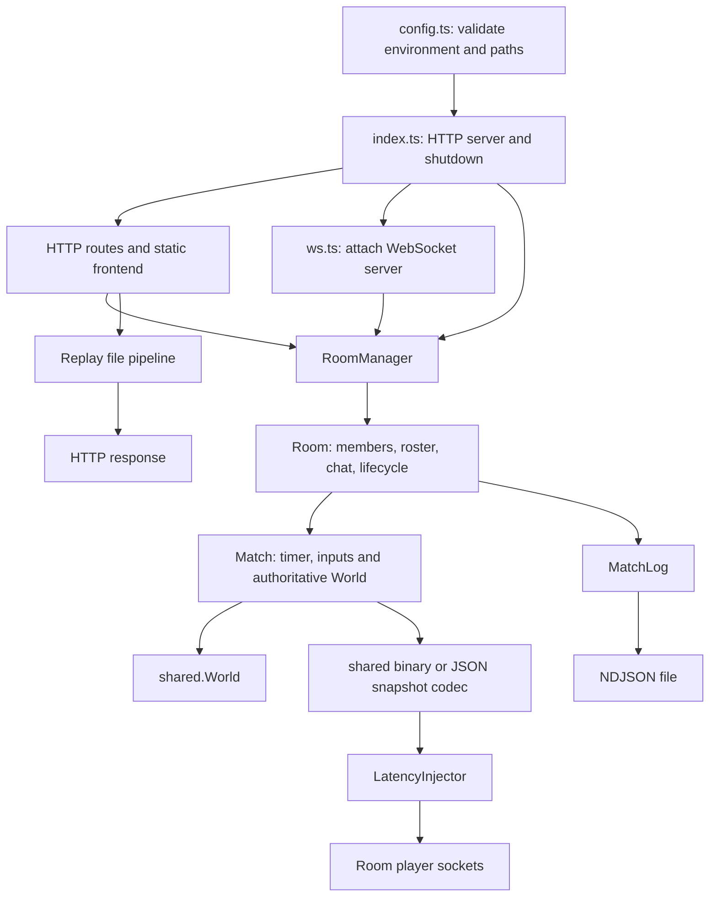
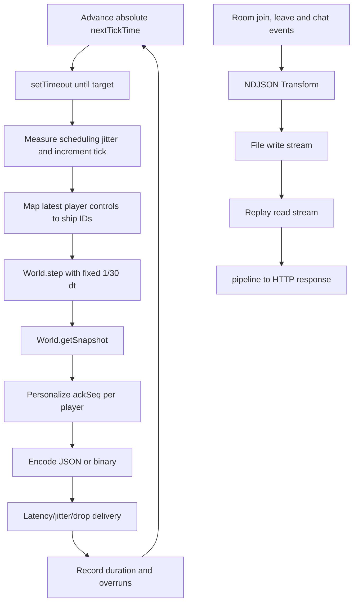

# Server architecture and file guide

This package runs a Node HTTP server and WebSocket endpoint. It owns the room list, player membership, authoritative Worlds, 30 Hz match scheduling, diagnostics and event-log streaming. Live room/player state is in memory; NDJSON logs do not act as a database that restores matches at startup.

This guide describes the current TypeScript implementation. Related guides: [client](../client/ARCHITECTURE.md) and [shared](../shared/ARCHITECTURE.md).

## Ownership and entry points



Each Room constructs and starts one Match and one MatchLog. The manager seeds default persistent rooms; empty nonpersistent rooms are removed. Persistent here means retained by the manager while the process runs, not saved across process restarts.

## Joining and sending input

```mermaid
sequenceDiagram
  participant Browser
  participant WS as ws.ts
  participant Manager as RoomManager
  participant Room
  participant Match
  participant World as shared.World
  Browser->>WS: Open /ws and send join
  WS->>WS: Validate, rate-limit, enforce join deadline
  WS->>Manager: Find requested room
  Manager-->>WS: Room
  WS->>Room: join(player)
  Room->>Match: addPlayer(player)
  Match->>World: Spawn authoritative ship
  Room-->>Browser: Welcome; broadcast updated membership
  Browser->>WS: Input with seq
  WS->>WS: Decode/validate and apply input rate limit
  WS->>Match: queueInput(playerId, input)
  Note over Match: Retain latest input per player
  Match->>World: step(1/30, input map)
  Match-->>Browser: Encoded snapshot with personalized ackSeq
```

pendingInputs is a latest-control map, not a FIFO that simulates every received command. queueInput updates lastProcessedSeq when input is accepted; the next snapshot is broadcast after a World step. Multiple inputs can be coalesced before that step. Explain that distinction when discussing acknowledgements.

The active snapshot codec and latency injector belong to the Match, so network experiment configuration applies at room-match scope.

## Tick and log flows



Room event logs and network snapshots have different roles. The logs record the events supplied to MatchLog; they are not a recording of every simulation state. Replay streaming downloads log data, while createReplayEvents exposes validated line-by-line event iteration.

## HTTP and socket surface

- GET /health — Process health information.
- GET /api/rooms — Room list.
- POST /api/rooms — Validate room creation data and create a room.
- GET /api/stats — Server/match diagnostics.
- GET /api/slow?ms=300 — Deliberately blocking teaching experiment.
- GET /api/replays/:filename — Stream a log file.
- Other static requests — Serve the built client from client/dist.
- /ws — Join/input/chat/leave/ping/config messages, plus authoritative snapshots and membership replies.

ws.ts includes payload size limits, separate control/input token buckets, join timeout, heartbeat, close cleanup and a bufferedAmount check in its JSON receive path. The snapshot sender is a separate path in Match; do not interpret the receive-path check as universal outbound backpressure handling.

## File-by-file walkthrough

Paths are relative to server/.

### Runtime and configuration

- [ ] [package.json](package.json) — Workspace scripts running TypeScript through tsx; shared and ws dependencies.
- [ ] [tsconfig.json](tsconfig.json) — Strict root settings with NodeNext resolution and Node runtime types.
- [ ] [src/index.ts](src/index.ts) — Compose server/rooms/sockets, route HTTP, safely resolve static files, stream replays and shut down on signals.
- [ ] [src/config.ts](src/config.ts) — Parse process.env through shared validation, resolve log/client build paths and create the log directory. It does not automatically load a .env file.
- [ ] [src/protocol.ts](src/protocol.ts) — Thin adapter from shared Result parsing to the server's valid/msg or code/reason shape; re-exports protocol constants.
- [ ] [src/ws.ts](src/ws.ts) — Attach WebSocket server, decode/dispatch messages, enforce limits, manage heartbeat/join deadline and clean up closed connections.
- [ ] [src/rooms.ts](src/rooms.ts) — Typed EventEmitter Room, player map, roster/chat broadcasts, match/log ownership and RoomManager creation/deletion/default rooms.
- [ ] [src/match.ts](src/match.ts) — Authoritative World, player ships, latest inputs, sequence tracking, target-time tick loop, snapshots and timing statistics.
- [ ] [src/latency.ts](src/latency.ts) — Schedule deliveries with configurable latency, jitter and simulated drops.
- [ ] [src/log/matchlog.ts](src/log/matchlog.ts) — Convert event objects into NDJSON with a Transform and file pipeline; close/flush the log.
- [ ] [src/log/replay.ts](src/log/replay.ts) — Validate/iterate NDJSON events with readline and stream files into HTTP responses with pipeline.

### Tests

These tests live here even when the subject is a shared module or browser connection.

- [ ] [test/server.test.js](test/server.test.js) — HTTP, protocol, socket/room lifecycle and log/replay integration.
- [ ] [test/match.test.js](test/match.test.js) — Match stepping, input handling, snapshots and network components.
- [ ] [test/determinism.test.js](test/determinism.test.js) — Compare shared simulation outcomes under equal seeds/inputs and exercise World behavior.
- [ ] [test/codec.test.js](test/codec.test.js) — Binary layouts, round trips and codec behavior.
- [ ] [test/client-connection.test.js](test/client-connection.test.js) — Browser connection behavior exercised through a test environment.
- [ ] [test/migration.test.js](test/migration.test.js) — Compare TypeScript simulation behavior with the historical lab-05 implementation loaded from Git.
- [ ] [test/lab06.test.js](test/lab06.test.js) — Runtime boundaries, validation, entity ID and binary regressions, and real WebSocket cases.

The default server/logs/ directory is generated runtime output and may not exist until startup. Installed dependencies and generated logs are outside the authored-file reference.

## Run and inspect

From the repository root:

```powershell
npm.cmd ci
npm.cmd run dev:server
```

In another terminal:

```powershell
Invoke-RestMethod 'http://localhost:3000/health'
Invoke-RestMethod 'http://localhost:3000/api/stats' | ConvertTo-Json -Depth 8
```

- [ ] Trace a join from ws.ts to Room.join, Match.addPlayer and the welcome reply.
- [ ] Trace one input to the next match tick and personalized snapshot.
- [ ] Explain how the file pipeline reacts when its destination is slow.
- [ ] Follow gracefulShutdown through closing sockets, matches and logs.
- [ ] Run npm.cmd run typecheck --workspace=server and npm.cmd test from the root. The migration test needs the lab-05 Git tag.
- [ ] For built frontend serving, run npm.cmd run build and then npm.cmd start from the root; open http://localhost:3000.

