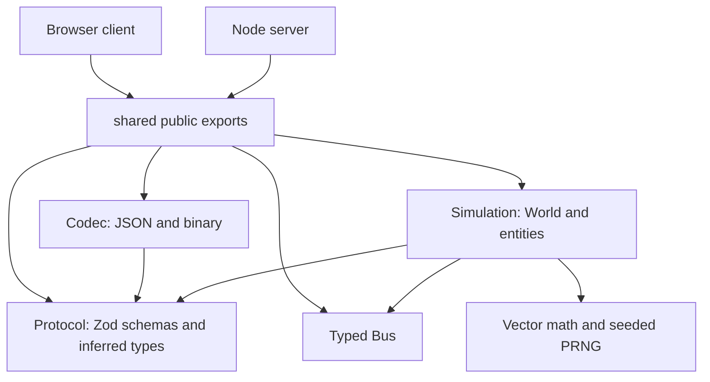
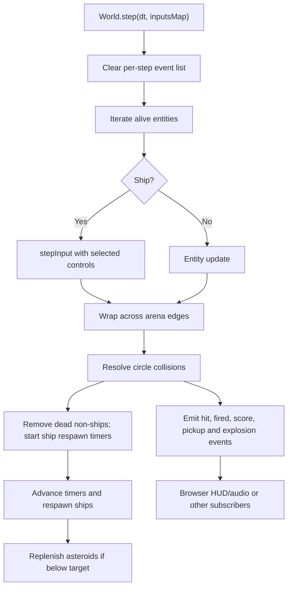
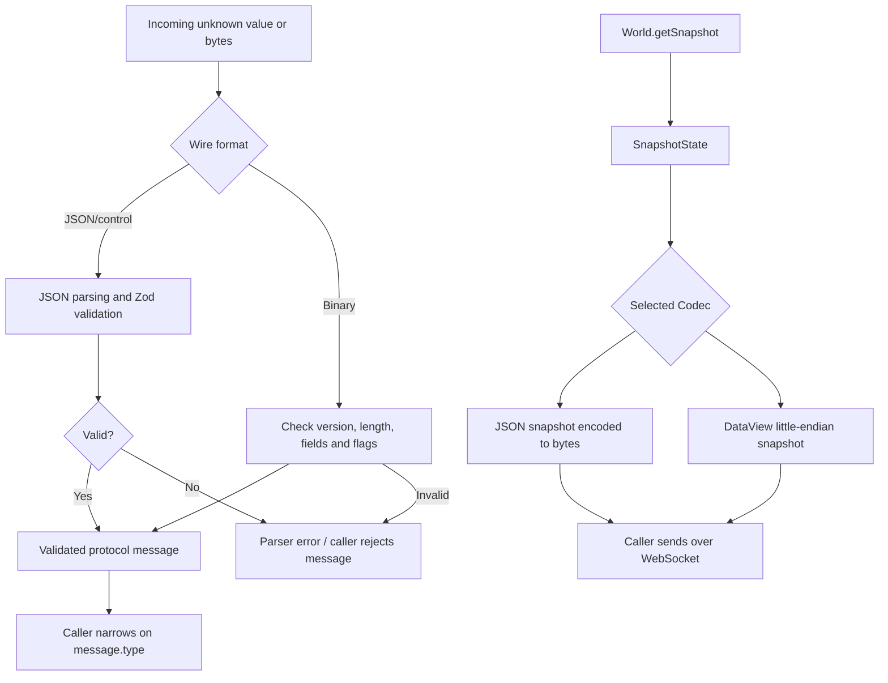

# Shared architecture and file guide

This package defines rules and contracts used by both browser and Node. It provides entity simulation, typed events, runtime message schemas and JSON/binary codecs. It does not run a server, open a socket or draw a frame.

This guide describes the current TypeScript implementation. Related guides: [client](../client/ARCHITECTURE.md) and [server](../server/ARCHITECTURE.md).

## Consumers and module boundaries

The workspace exports shared, shared/sim, shared/protocol and shared/codec directly from TypeScript source. Vite processes it for the browser and tsx executes it for Node. There is no required precompiled shared build.

Protocol numeric brands distinguish EntityId, Tick and Seq at compile time, with validating constructors for runtime values. Schemas validate external values; readonly snapshot types constrain TypeScript consumers. Neither brands nor readonly create a separate numeric representation or runtime deep freeze.

## One simulation step

World stores a union of Ship, Bullet, Asteroid and Pickup in a Map keyed by EntityId. It allocates bounded wire IDs without overwriting live entities. Entity owns common state; one inheritance level supplies entity-specific behavior. Homing and pickup effects use composition.

Simulation repeatability requires equal initial state, seeds, ordered inputs and timesteps. Server ticks normally use 1/30 second, client steps normally use 1/60 second, and client prediction adds its own update path. Sharing these classes does not guarantee equal live state. World.getSnapshot has a default wall-clock timestamp, so reproducible snapshots must also control that argument.

## Network boundary and wire formats

The Codec interface in codecs.ts is specifically a snapshot interface. Other exported helpers encode/decode inputs, ping/pong and network configuration. Selecting binary does not turn every control message into binary.

The binary snapshot uses a 16-byte header and 24-byte entity records; input frames use 14 bytes. Angle/turn quantization uses a factor of 1000. spec.ts defines the exact shared sizes; binaryCodec.ts applies explicit little-endian DataView reads/writes.

## File-by-file walkthrough

Paths are relative to shared/.

### Package and events

- [ ] [package.json](package.json) — Workspace identity, TypeScript source export paths and typecheck command.
- [ ] [tsconfig.json](tsconfig.json) — Inherits strict settings, uses NodeNext resolution and checks source without emitting output.
- [ ] [src/index.ts](src/index.ts) — Root export surface combining simulation, protocol, codecs and Bus.
- [ ] [src/events.ts](src/events.ts) — Generic typed event Bus; on returns unsubscribe, emit invokes listeners synchronously, and clear removes subscriptions.

### Protocol

- [ ] [src/protocol/index.ts](src/protocol/index.ts) — Public protocol entry point re-exporting protocol.ts.
- [ ] [src/protocol/protocol.ts](src/protocol/protocol.ts) — Zod schemas, inferred message/entity unions, numeric brands/constructors, Result parsers, server configuration, constants, room creation schema and assertNever.
- [ ] [src/protocol/types.ts](src/protocol/types.ts) — Compatibility re-exports of protocol version and message/entity/pickup constants; schema definitions remain in protocol.ts.

### Codecs

- [ ] [src/codec/index.ts](src/codec/index.ts) — Public codec entry point.
- [ ] [src/codec/codecs.ts](src/codec/codecs.ts) — Snapshot Codec interface and binaryCodec/jsonCodec adapters.
- [ ] [src/codec/spec.ts](src/codec/spec.ts) — Binary version, frame/record sizes, byte order and quantization factors.
- [ ] [src/codec/binaryCodec.ts](src/codec/binaryCodec.ts) — DataView conversion, typed binary encode/decode helpers, layout/range validation and frame-type dispatch.
- [ ] [src/codec/jsonCodec.ts](src/codec/jsonCodec.ts) — JSON input/snapshot encoding and validated decoding.

### Simulation

- [ ] [src/sim/index.ts](src/sim/index.ts) — Public simulation exports, including entity types and helper functions.
- [ ] [src/sim/vector.ts](src/sim/vector.ts) — Readonly 2D vector values and operations returning new vectors.
- [ ] [src/sim/prng.ts](src/sim/prng.ts) — Seeded Mulberry32 generator and PRNG wrapper for repeatable random choices.
- [ ] [src/sim/arena.ts](src/sim/arena.ts) — Boundary wrapping and previous-state adjustment to avoid interpolation across the whole arena.
- [ ] [src/sim/entity.ts](src/sim/entity.ts) — Common entity ID, position, velocity, radius and alive state, plus protocol type re-exports.
- [ ] [src/sim/ship.ts](src/sim/ship.ts) — Movement constants/integration, input application, health/shield, firing, effects, respawn and snapshot conversion.
- [ ] [src/sim/bullet.ts](src/sim/bullet.ts) — Projectile movement, lifetime, owner/damage data, optional homing and snapshot conversion.
- [ ] [src/sim/asteroid.ts](src/sim/asteroid.ts) — Asteroid tier, health, generated vertices, movement/rotation and snapshot conversion; collision responses are in collision.ts.
- [ ] [src/sim/pickup.ts](src/sim/pickup.ts) — Pickup entity state, movement/pulse, effect application and snapshot conversion.
- [ ] [src/sim/components.ts](src/sim/components.ts) — Reusable homing steering, angle normalization and pickup effects such as shield, rapid fire, homing and healing.
- [ ] [src/sim/collision.ts](src/sim/collision.ts) — Circle intersection, naive pair search and gameplay collision responses, scoring and emitted events.
- [ ] [src/sim/world.ts](src/sim/world.ts) — Entity registry/ID allocation, typed World events, seeded spawning, stepping, collision/cleanup/respawn sequencing and snapshot save/load.

## Reading and verification checklist

- [ ] Start with src/index.ts to find the public API.
- [ ] Follow World.step into Ship.stepInput and collision resolution.
- [ ] Trace World.getSnapshot into a codec and then client reconciliation.
- [ ] Explain the difference between a compile-time brand and runtime schema validation.
- [ ] Explain why pure simulation code has no need for Canvas, DOM elements or WebSocket objects.
- [ ] Run npm.cmd run typecheck --workspace=shared from the repository root.
- [ ] Run npm.cmd test from the root for shared codec/determinism/migration coverage in server/test.

There is no standalone shared development server. package.json exposes source files; any node_modules/ or emitted dist/ contents are generated and outside this authored-file reference. Changes to shared contracts must be considered in both consuming packages.

